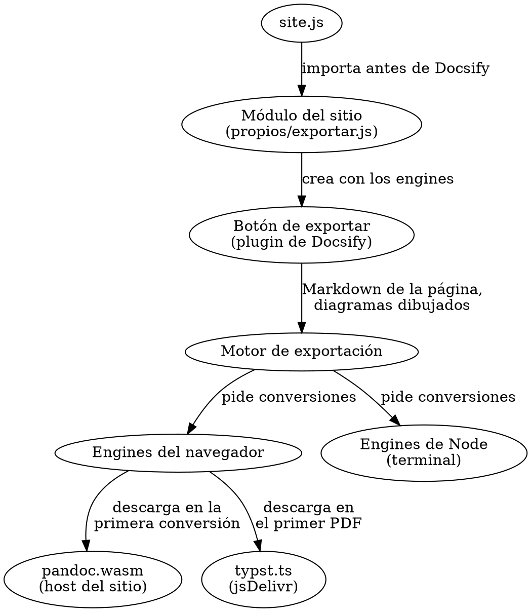

<!-- Hecho con `npm run docs:pr -- packages/docs-site/docs/prs/55.html` desde la página de summarize-pr. Para cambiarlo, cambiá 55.html y regeneralo. -->

# docs-export: transporte browser (wasm externo) y plugin exportButton para Docsify 5

<!-- as: pr-header repo="https://github.com/Kiri23/DocsifyTemplate" pr="55" head="aca3339440a7ed3ac73eb711ee09f53ed3d10653" additions="1231" deletions="22" shown-additions="180" shown-deletions="12" -->
[Ver el original](55.html) · hecho con [summarize-pr](https://github.com/MeLlamoPablo/skills/tree/72199a8/skills/summarize-pr)

<!-- as: story -->
> **Before**, exportar una página de Docsify a <dfn class="term" data-tip="Lenguaje de documentos que compila a PDF. Un archivo `.typ` es texto plano.">Typst</dfn> (`.typ`) o PDF solo se podía desde la terminal (`npm run docs:exportar`).
>
> **Now**, un botón en el sitio con **Descargar .typ** y **Descargar .pdf** arma el archivo en el navegador, sin servidor. El `.typ` es texto que un agente puede leer y editar; el PDF es para personas, con la plantilla de marca (`branded.typ`).

El botón es un plugin común de Docsify y no depende de `site.js`: cualquier sitio Docsify puede ofrecer su documentación en PDF con la plantilla de marca a alguien sin acceso al repo. El <dfn class="term" data-tip="La parte que convierte una página (de Markdown a Typst o PDF) sin saber si corre en la terminal o en el navegador.">motor</dfn> de exportación que ya corría en Node ahora corre en el navegador: solo cambian los <dfn class="term" data-tip="El objeto con el que el motor convierte: `pandoc`, `compilePdf`, `parseMarkdown` y `parseHtml`. Node y el navegador dan cada uno el suyo.">engines</dfn> que recibe.

Nadie probó el botón en Firefox (solo en Chromium). Cierra [#50](https://github.com/Kiri23/DocsifyTemplate/issues/50).

## Flujo

<!-- as: chart -->


- `SITE`: [packages/docs-site/site.js#L97-L101](https://github.com/Kiri23/DocsifyTemplate/blob/aca3339440a7ed3ac73eb711ee09f53ed3d10653/packages/docs-site/site.js#L97-L101)
- `BTN`: [packages/docs-export/transportes/docsify/export-button.js#L54-L117](https://github.com/Kiri23/DocsifyTemplate/blob/aca3339440a7ed3ac73eb711ee09f53ed3d10653/packages/docs-export/transportes/docsify/export-button.js#L54-L117)
- `MOTOR`: [packages/docs-export/motor/export.js#L125-L151](https://github.com/Kiri23/DocsifyTemplate/blob/aca3339440a7ed3ac73eb711ee09f53ed3d10653/packages/docs-export/motor/export.js#L125-L151)
- `ENG`: [packages/docs-export/transportes/browser/engines.js#L36-L94](https://github.com/Kiri23/DocsifyTemplate/blob/aca3339440a7ed3ac73eb711ee09f53ed3d10653/packages/docs-export/transportes/browser/engines.js#L36-L94)
- `PANDOC`: [packages/docs-export/transportes/browser/pandoc-wasm.js#L15-L83](https://github.com/Kiri23/DocsifyTemplate/blob/aca3339440a7ed3ac73eb711ee09f53ed3d10653/packages/docs-export/transportes/browser/pandoc-wasm.js#L15-L83)
- `TYPST`: [packages/docs-export/transportes/browser/typst-wasm.js#L5-L22](https://github.com/Kiri23/DocsifyTemplate/blob/aca3339440a7ed3ac73eb711ee09f53ed3d10653/packages/docs-export/transportes/browser/typst-wasm.js#L5-L22)
- `CLI`: [packages/docs-export/transportes/node/engines.js#L78-L127](https://github.com/Kiri23/DocsifyTemplate/blob/aca3339440a7ed3ac73eb711ee09f53ed3d10653/packages/docs-export/transportes/node/engines.js#L78-L127)

## Cómo lo prende un sitio

El plugin no viene prendido. Con `site.js`, el sitio nombra un módulo suyo en `pluginModules`:

<!-- as: example -->
```javascript
// index.html, antes de cargar site.js: el sitio nombra su módulo de plugins.
window.$docsify = { name: "Mi sitio", pluginModules: ["propios/exportar.js"] };
```

<!-- as: example -->
```javascript
// propios/exportar.js: cada export de este módulo es un plugin de Docsify.
// ".../" = https://rawcdn.githack.com/Kiri23/DocsifyTemplate/<tag>/packages/
import * as componentes from "docs-site/components/mod.js";
import { browserEngines } from ".../docs-export/transportes/browser/mod.js";
import { exportButton } from ".../docs-export/transportes/docsify/mod.js";

// Dibuja "Descargar .typ" y "Descargar .pdf" arriba de cada página.
export const exportar = exportButton({
  engines: browserEngines({ pandocWasmUrl: "https://assets.test/pandoc.wasm" }),
  components: Object.values(componentes),
});
```

Sin `site.js`, el sitio suma el mismo `exportButton(…)` a `window.$docsify.plugins` desde un `<script type="module">` antes del `<script defer>` de Docsify (el README tiene el ejemplo entero).

Salida real: en una página “Página sin site.js” con “Un párrafo con **negrita**.”, el botón descargó `pagina-sin-site-js.typ` con `= Página sin site.js` y `Un párrafo con #strong[negrita].`

## Carga de plugins en site.js

<!-- as: decision origin="implicit" -->
**Clave nueva `pluginModules` en `site.js`**

- **Why:** Docsify tiene que tener el plugin antes de arrancar. `site.js` importa los módulos de `pluginModules` en su propio módulo, antes del `<script defer>` de Docsify. Sin la clave, `site.js` hace lo mismo que antes.
- **Trade-off:** `site.js` tiene una clave más. Para revertir: sacarla; el botón sigue entrando por `window.$docsify.plugins`, como sin `site.js`.
- **Discarded idea:** Un `<script type="module">` en la página que suma el plugin. Antes de `site.js`, Firefox ignora el import map; después, Docsify puede arrancar sin el plugin.

<!-- as: diff path="packages/docs-site/site.js" line="93" lang="javascript" href="https://github.com/Kiri23/DocsifyTemplate/pull/55/files#diff-73984ba1f7574cd8b064b77b09c952429701eee315328d6529a206e69ddbbcb4R93" -->
```javascript
(function () {
  // ...

  var ownModules = (own.components || []).map(function (src, i) {
    return { name: "own" + i, src: src, url: new URL(src, document.baseURI).href };
  });

  document.write(
    // ...
      ownModules.map(function (m) {
        return "import * as " + m.name + " from " + JSON.stringify(m.url) + ";";
      }).join("") +
      // ...
      "c.plugins = [" +
      // ...
      "onThisPage(), prevNext(), codeWindow()," +
      "].concat(c.plugins || []);" +
      // ...
  );
})();
```

```javascript
(function () {
  // ...

  var componentModules = (own.components || []).map(function (src, i) {
    return { name: "own" + i, src: src, url: new URL(src, document.baseURI).href };
  });

  // The repo's plugin modules, imported by the same module, so they are ready before Docsify.
  var pluginModules = (own.pluginModules || []).map(function (src, i) {
    return { name: "plugins" + i, src: src, url: new URL(src, document.baseURI).href };
  });
  var repoModules = componentModules.concat(pluginModules);

  document.write(
    // ...
      repoModules.map(function (m) {
        return "import * as " + m.name + " from " + JSON.stringify(m.url) + ";";
      }).join("") +
      // ...
      "c.plugins = [" +
      // ...
      "onThisPage(), prevNext(), codeWindow()," +
      "].concat([" + pluginModules.map(function (m) { return m.name; }).join(",") + "]" +
      ".flatMap((m) => Object.values(m)), c.plugins || []);" +
      // ...
  );
})();
```

## Botón de exportar

<!-- as: decision origin="implicit" -->
**`exportButton` recibe los engines, no la dirección de `pandoc.wasm`**

- **Why:** Con los engines como argumento, el plugin no depende del navegador y acepta otro motor. El ticket pedía `exportButton({ pandocWasmUrl })`.
- **Trade-off:** El sitio escribe `exportButton({ engines: browserEngines({ pandocWasmUrl }) })`. Para revertir: que `exportButton` acepte `pandocWasmUrl` y arme `browserEngines` adentro (un valor por defecto en `transportes/docsify/export-button.js`).

<!-- as: diff path="packages/docs-export/transportes/docsify/export-button.js" line="12" lang="javascript" only="new" href="https://github.com/Kiri23/DocsifyTemplate/pull/55/files#diff-28e766373521765189699ab63869807ddd926069df8e5cf8603f6331ff565ec8R12" -->
```javascript
// What each button produces: how the motor makes it and how the browser saves it.
const FORMATS = Object.freeze({
  typ: Object.freeze({
    label: "Descargar .typ",
    // ...
    build: (pageExport, engines) => pageExport.toTypst(engines),
  }),
  pdf: Object.freeze({
    label: "Descargar .pdf",
    // ...
    build: (pageExport, engines) => pageExport.toPdf(engines),
  }),
});

/** Creates the Docsify plugin that exports each page with the given engines. */
export function exportButton({
  engines,
  components,
  formats = ["typ", "pdf"],
  templateUrl = DEFAULT_TEMPLATE_URL,
  mermaidFilterUrl = DEFAULT_MERMAID_FILTER_URL,
  /* ... */
} = {}) {
  // ...

  return (hook) => {
    let pageMarkdown = "";

    hook.beforeEach((markdown) => {
      pageMarkdown = markdown;
      return markdown;
    });

    hook.doneEach(() => {
      const section = document.querySelector(".markdown-section");
      if (!section || section.querySelector(`.${BAR_CLASS}`)) return;

      // ...
      section.prepend(bar);
    });
  };
}

/** Runs the motor on one page, saves the file, and tells how it went in the bar. */
async function exportAndSave({ markdown, section, document }, format, status, settings) {
  // ...
  try {
    const title = section.querySelector("h1")?.textContent.trim();
    let pageExport = Export.ofMarkdown(markdown)
      .templateSource(await fetchTextOnce(templateUrl))
      .onWarning((message) => warnings.push(message));
    // ...

    // Only drawn diagrams go in; without them the Mermaid blocks stay as code.
    const diagrams = captureMermaidSvgs(section);
    if (diagrams.length > 0) {
      pageExport = pageExport
        .mermaidFilterSource(await fetchTextOnce(mermaidFilterUrl))
        .mermaidSvgs(diagrams);
    }

    const content = await format.build(pageExport, engines);
    saveDownload(document, {
      filename: filenameFromTitle(title, format.extension),
      mime: format.mime,
      content,
    });
    for (const message of warnings) console.warn(`docs-export: ${message}`);
    status.textContent =
      warnings.length > 0 ? `Listo, con ${warnings.length} aviso(s) en la consola.` : "";
  } catch (error) {
    console.error("docs-export:", error);
    status.textContent = `No se pudo exportar: ${error.message}`;
  }
}
```

## Diagramas Mermaid

Si la página dibujó diagramas Mermaid, el PDF los lleva como imagen. El botón copia cada diagrama que Mermaid dibujó en la página:

<!-- as: diff path="packages/docs-export/transportes/browser/mermaid-capture.js" line="11" lang="javascript" only="new" href="https://github.com/Kiri23/DocsifyTemplate/pull/55/files#diff-96fa962c8a5a4cf872c077a5514c74012e3d681f2302b2a3970f9899ba8ef383R11" -->
```javascript
/** Collects every drawn Mermaid diagram under the page, in page order, as SVG text. */
export function captureMermaidSvgs(root) {
  const doc = root.ownerDocument ?? root;
  const svgs = [];
  for (const svg of root.querySelectorAll(".mermaid svg")) {
    const clone = svg.cloneNode(true);

    //! Typst can't draw the HTML labels that Mermaid puts in the diagram.
    for (const box of [...clone.querySelectorAll("foreignObject")]) {
      box.parentNode.replaceChild(plainLabelFor(box, doc), box);
    }

    // ...
    svgs.push(clone.outerHTML);
  }
  return svgs;
}
```

El motor manda el <dfn class="term" data-tip="Un filtro Lua que Pandoc corre: cambia cada bloque Mermaid por una marca `%%MERMAID_SVG_n%%`, y el motor después pone el diagrama n en esa marca.">filtro Mermaid</dfn> a Pandoc solo cuando hay diagramas capturados:

<!-- as: diff path="packages/docs-export/motor/pandoc-options.js" line="39" lang="javascript" href="https://github.com/Kiri23/DocsifyTemplate/pull/55/files#diff-865afe530b9a8f8c013aa5d88b0822f1ec356aac8317388e571252a71b38a89eR39" -->
```javascript
export function buildPandocRequest(config = {}) {
  // ...

  if (config.mermaidFilterSource !== undefined) {
    files[MERMAID_FILTER_FILE] = config.mermaidFilterSource;
    options.filters = [MERMAID_FILTER_FILE];
  }

  return { options, files };
}
```

```javascript
export function buildPandocRequest(config = {}) {
  // ...

  // Without captured diagrams the filter would only erase the Mermaid code, so it stays out
  // and the blocks are exported as code.
  if (config.mermaidFilterSource !== undefined && config.mermaidSvgs?.length > 0) {
    files[MERMAID_FILTER_FILE] = config.mermaidFilterSource;
    options.filters = [MERMAID_FILTER_FILE];
  }

  return { options, files };
}
```

Si falta algún diagrama, el PDF lleva una nota visible en su lugar y la consola muestra un aviso.

<!-- as: diff path="packages/docs-export/motor/mermaid.js" line="7" lang="javascript" href="https://github.com/Kiri23/DocsifyTemplate/pull/55/files#diff-3da26047cccbf9c869cef0ec6ef13cb2dda3d015522e263cafd192dbe43dd404R7" -->
```javascript
/** Replaces each Mermaid placeholder with its matching diagram, or removes it when absent. */
export function inlineMermaidSvgs(typstSource, svgs = []) {
  return typstSource.replace(PLACEHOLDER, (_match, indexText) => {
    const index = Number(indexText);
    if (!Number.isInteger(index) || index < 0 || index >= svgs.length) return "";
    const svg = svgs[index];
    if (!svg) return "";
    return `#image(bytes("${escapeTypstString(svg)}"), format: "svg", width: 80%)`;
  });
}
```

```javascript
// What the document shows where a diagram was expected but none was captured.
export const MISSING_DIAGRAM_NOTE = "#emph[(diagrama Mermaid no capturado)]";

/** Replaces each Mermaid placeholder with its matching diagram, or a visible note when absent. */
export function inlineMermaidSvgs(typstSource, svgs = [], { onWarning } = {}) {
  return typstSource.replace(PLACEHOLDER, (_match, indexText) => {
    const index = Number(indexText);
    const svg = Number.isInteger(index) && index >= 0 ? svgs[index] : undefined;
    if (!svg) {
      onWarning?.(`el diagrama Mermaid ${index + 1} no se capturó; queda una nota en su lugar`);
      return MISSING_DIAGRAM_NOTE;
    }

    return `#image(bytes("${escapeTypstString(svg)}"), format: "svg", width: 80%)`;
  });
}
```

<!-- as: diff path="packages/docs-export/motor/export.js" line="147" lang="javascript" href="https://github.com/Kiri23/DocsifyTemplate/pull/55/files#diff-caecf0af7590ddce1740ec2dbd269ba4d450f799cae9aafb0d54352a195fd0abR147" -->
```javascript
export class Export {
  // ...

  async toTypst(engines) {
    // ...
    const { options, files } = this.toPandocRequest();
    const rawTypst = await engines.pandoc({ options, stdin: markdown, files });
    // ...

    if (this.#state.mermaidSvgs) {
      return inlineMermaidSvgs(rawTypst, this.#state.mermaidSvgs);
    }
    return rawTypst;
  }
}
```

```javascript
export class Export {
  // ...

  async toTypst(engines) {
    // ...
    const { options, files } = this.toPandocRequest();
    const rawTypst = await engines.pandoc({ options, stdin: markdown, files });
    // ...

    if (this.#state.mermaidSvgs?.length > 0) {
      return inlineMermaidSvgs(rawTypst, this.#state.mermaidSvgs, {
        onWarning: this.#state.onWarning,
      });
    }
    return rawTypst;
  }
}
```

## Engines del navegador

Para que el botón funcione en un sitio publicado (no bloquea el merge), alguien tiene que servir `pandoc.wasm` desde un host con CORS (por ejemplo, Caddy en el VPS). Pesa unos 56 MB: no entra a git, y jsDelivr no sirve archivos de más de 50 MB. Typst se baja de jsDelivr (`@myriaddreamin/typst-all-in-one.ts`) solo al pedir un PDF.

<!-- as: diff path="packages/docs-export/transportes/browser/engines.js" line="13" lang="javascript" only="new" href="https://github.com/Kiri23/DocsifyTemplate/pull/55/files#diff-959900799d870e1a82837a5441bf2ad6778edc3edf97e5934e4ce1334285bf00R13" -->
```javascript
/** Remembers the first result of a loader, so that each download happens once.
 * After a failure, the next call downloads again. */
function loadOnce(load) {
  // ...
}

/** Runs one job at a time: pandoc.wasm keeps one virtual folder that each run empties. */
function oneAtATime() {
  // ...
}

/** Creates the WebAssembly Pandoc, Typst, and parser adapters consumed by Export. */
export function browserEngines({
  pandocWasmUrl,
  typstUrl = DEFAULT_TYPST_URL,
  wasiShimUrl = DEFAULT_WASI_SHIM_URL,
  marked,
  /* ... */
} = {}) {
  // ...

  const pandocWasm = loadOnce(async () =>
    startPandocWasm({
      wasmUrl: pandocWasmUrl,
      wasiShim: await importModule(wasiShimUrl),
      fetchWasm,
    }),
  );
  const inPandocQueue = oneAtATime();
  const typstCompiler = loadOnce(async () => typstCompilerFrom(await importModule(typstUrl)));

  return {
    // Components read the page with the same parser Docsify used to draw it, found when a page
    // is exported, once Docsify has loaded.
    parseMarkdown: {
      lexer: (source) => markedParser().lexer(source),
      parser: (tokens) => markedParser().parser(tokens),
    },

    parseHtml(html) {
      // ...
    },

    async pandoc({ options, stdin, files = {} }) {
      const { convert } = await pandocWasm();
      const { stdout, stderr } = await inPandocQueue(() => convert({ options, stdin, files }));
      if (!stdout && stderr) throw new Error(`pandoc.wasm falló: ${stderr.trim()}`);

      // ...
      return stdout;
    },

    async compilePdf(typstSource) {
      const { compilePdf } = await typstCompiler();
      return compilePdf(typstSource);
    },
  };
}
```

`pandoc-wasm.js` adapta `pandoc.js`, la interfaz JavaScript que viene con `pandoc.wasm` (licencia MIT, Tweag I/O y John MacFarlane). La función que arranca el runtime de Haskell es una copia sin cambios: nadie la revisó línea por línea.

## Tests

<!-- as: tests -->
- `packages/docs-site/test/site.test.mjs`
  - added L240: [site.js without pluginModules imports no extra module and keeps the theme's plugins first](https://github.com/Kiri23/DocsifyTemplate/pull/55/files#diff-d731940a02b5156e39d65bd04589c00267adb15387ed0ddf55f030868a0ef5beR240)
  - added L249: [site.js imports pluginModules in its module and puts their exports after the theme's plugins](https://github.com/Kiri23/DocsifyTemplate/pull/55/files#diff-d731940a02b5156e39d65bd04589c00267adb15387ed0ddf55f030868a0ef5beR249)
- `packages/docs-export/test/export-button.test.mjs`
  - added L97: [exportButton draws one bar with .typ and .pdf buttons at the top of the page](https://github.com/Kiri23/DocsifyTemplate/pull/55/files#diff-7474990dec24a8a92a05dd511c1b28062877ba5289c3d6dbafc617e4e7123bbaR97)
  - added L119: [.typ button downloads the page's Typst with its drawn Mermaid diagram](https://github.com/Kiri23/DocsifyTemplate/pull/55/files#diff-7474990dec24a8a92a05dd511c1b28062877ba5289c3d6dbafc617e4e7123bbaR119)
  - added L153: [a failed export says why in the bar and frees the buttons](https://github.com/Kiri23/DocsifyTemplate/pull/55/files#diff-7474990dec24a8a92a05dd511c1b28062877ba5289c3d6dbafc617e4e7123bbaR153)
  - added L171: [the plugin downloads template and filter from their addresses once](https://github.com/Kiri23/DocsifyTemplate/pull/55/files#diff-7474990dec24a8a92a05dd511c1b28062877ba5289c3d6dbafc617e4e7123bbaR171)
  - added L192: [a page without drawn diagrams sends no Mermaid filter to Pandoc and does not download it](https://github.com/Kiri23/DocsifyTemplate/pull/55/files#diff-7474990dec24a8a92a05dd511c1b28062877ba5289c3d6dbafc617e4e7123bbaR192)
  - added L205: [with browserEngines, components read the page with Docsify's window.marked](https://github.com/Kiri23/DocsifyTemplate/pull/55/files#diff-7474990dec24a8a92a05dd511c1b28062877ba5289c3d6dbafc617e4e7123bbaR205)
  - added L225: [with real Pandoc and the real Lua filter, the drawn diagram replaces its Mermaid block](https://github.com/Kiri23/DocsifyTemplate/pull/55/files#diff-7474990dec24a8a92a05dd511c1b28062877ba5289c3d6dbafc617e4e7123bbaR225)
  - added L250: [after moving to another page, the button exports that page](https://github.com/Kiri23/DocsifyTemplate/pull/55/files#diff-7474990dec24a8a92a05dd511c1b28062877ba5289c3d6dbafc617e4e7123bbaR250)
  - added L263: [the motor's warnings reach the bar and the console](https://github.com/Kiri23/DocsifyTemplate/pull/55/files#diff-7474990dec24a8a92a05dd511c1b28062877ba5289c3d6dbafc617e4e7123bbaR263)
  - added L283: [a template that failed to download is asked for again on the next click](https://github.com/Kiri23/DocsifyTemplate/pull/55/files#diff-7474990dec24a8a92a05dd511c1b28062877ba5289c3d6dbafc617e4e7123bbaR283)
- `packages/docs-export/test/mermaid-capture.test.mjs`
  - added L26: [captureMermaidSvgs turns HTML labels into centered SVG text Typst can draw](https://github.com/Kiri23/DocsifyTemplate/pull/55/files#diff-74715cf64ea5b5077c418f10c381ac349733969163a60b87eeedaeb0503faf02R26)
  - added L37: [captureMermaidSvgs leaves the page untouched](https://github.com/Kiri23/DocsifyTemplate/pull/55/files#diff-74715cf64ea5b5077c418f10c381ac349733969163a60b87eeedaeb0503faf02R37)
- `packages/docs-export/test/mermaid.test.mjs`
  - removed L6: [inlineMermaidSvgs splices escaped SVGs and strips unmatched placeholders](https://github.com/Kiri23/DocsifyTemplate/pull/55/files#diff-8167e3da5000a39b751913ad6d2f5611ca8161d41b8368efa37d0a4beec25c8cL6)
  - added L6: [inlineMermaidSvgs splices escaped SVGs and leaves a visible note for unmatched placeholders](https://github.com/Kiri23/DocsifyTemplate/pull/55/files#diff-8167e3da5000a39b751913ad6d2f5611ca8161d41b8368efa37d0a4beec25c8cR6)
  - added L24: [inlineMermaidSvgs warns once per diagram it could not place](https://github.com/Kiri23/DocsifyTemplate/pull/55/files#diff-8167e3da5000a39b751913ad6d2f5611ca8161d41b8368efa37d0a4beec25c8cR24)
- `packages/docs-export/test/export.test.mjs`
  - added L116: [toTypst with the filter set and no diagrams keeps the Mermaid code instead of a placeholder](https://github.com/Kiri23/DocsifyTemplate/pull/55/files#diff-8b7ee3e7d4d822c366a303d86b739a7ecdb19b5ed88d0d172abc3df911bf16b8R116)
- `packages/docs-export/test/browser-transport.test.mjs`
  - added L35: [browserEngines downloads nothing until it is used](https://github.com/Kiri23/DocsifyTemplate/pull/55/files#diff-83dd20040c91699a47e8c69602f1c5f64d8d123664b131137f7f38f1e17dcb00R35)
  - added L62: [pandoc engine retries the download after a failure instead of remembering it](https://github.com/Kiri23/DocsifyTemplate/pull/55/files#diff-83dd20040c91699a47e8c69602f1c5f64d8d123664b131137f7f38f1e17dcb00R62)
  - added L74: [compilePdf loads typst once from the default address and returns its bytes](https://github.com/Kiri23/DocsifyTemplate/pull/55/files#diff-83dd20040c91699a47e8c69602f1c5f64d8d123664b131137f7f38f1e17dcb00R74)
  - added L131: [without marked and before Docsify loads, components fail saying which parser is missing](https://github.com/Kiri23/DocsifyTemplate/pull/55/files#diff-83dd20040c91699a47e8c69602f1c5f64d8d123664b131137f7f38f1e17dcb00R131)
  - added L142: [pandoc runs one conversion at a time, because pandoc.wasm shares one virtual folder](https://github.com/Kiri23/DocsifyTemplate/pull/55/files#diff-83dd20040c91699a47e8c69602f1c5f64d8d123664b131137f7f38f1e17dcb00R142)
  - added L217: [a pandoc.wasm run that prints only an error becomes an error with Pandoc's message](https://github.com/Kiri23/DocsifyTemplate/pull/55/files#diff-83dd20040c91699a47e8c69602f1c5f64d8d123664b131137f7f38f1e17dcb00R217)

<!-- as: callout label="Note" -->
> En `export-button.test.mjs`, el test “a page without drawn diagrams exports its Mermaid blocks as code, without the filter” no mira el Typst que sale: espera que Pandoc no reciba el filtro Mermaid y que el botón no descargue el archivo `.lua`.
