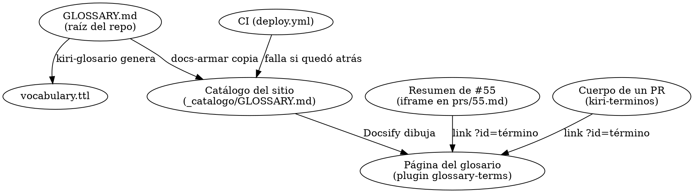

<!-- Hecho con `npm run docs:pr -- packages/docs-site/docs/prs/59.html` desde la página de summarize-pr. Para cambiarlo, cambiá 59.html y regeneralo. -->

# docs-site: glosario del repo en el sitio y resúmenes de PR (summarize-pr) enlazados a él

<!-- as: pr-header repo="https://github.com/Kiri23/DocsifyTemplate" pr="59" head="11ee4eff3e64b1022c1d5c375a712b1b8cb028be" additions="2879" deletions="6" shown-additions="109" shown-deletions="1" -->
[Ver el original](59.html) · hecho con [summarize-pr](https://github.com/MeLlamoPablo/skills/tree/72199a8/skills/summarize-pr)

<!-- as: story -->
> **Before**, ningún lugar definía los términos del repo. En [#55](https://github.com/Kiri23/DocsifyTemplate/pull/55) se confundieron <dfn class="term" data-glossary="site-js" data-tip="El script que un sitio carga en su index.html para levantar Docsify 5 con el tema, el import map y los componentes de este repo ya configurados.">site.js</dfn>, <dfn class="term" data-tip="Las herramientas con las que el Motor convierte (pandoc, el compilador de Typst), que cada Transporte da a su manera.">engines</dfn>, <dfn class="term" data-tip="La parte que convierte una página (de Markdown a Typst o PDF) sin saber si corre en la terminal o en el navegador.">motor</dfn> y <dfn class="term" data-tip="La parte que lleva el Motor a un lugar donde corre (la terminal, el navegador, un sitio Docsify) y le da sus engines.">transporte</dfn>.
>
> **Now**, el sitio tiene una página “Glosario” armada de `GLOSSARY.md`, como un diccionario: cada término con su dirección (`?id=engines`), una búsqueda y un índice de grupos. Una sección “Pull requests” muestra el resumen de cada PR, y sus términos llevan al glosario.

De un solo `GLOSSARY.md` salen dos cosas sin escribirlas dos veces: `vocabulary.ttl` para el grafo de ontologyLearning y la página del sitio. Fuera de este diff, en MyClaudeSkills, el script `kiri-glosario` ahora lee el <dfn class="term" data-tip="El formato de glosario del skill domain-modeling de Matt Pocock: `**Término**:`, la definición en la línea de abajo y `_Avoid_:` con los nombres que no hay que usar.">formato Pocock</dfn>, y el script nuevo `kiri-terminos` pone links al glosario en el cuerpo de un PR (pide la URL de la página con `--pagina`; no la adivina).

Nadie lo probó en Firefox (solo en Chromium headless). Hasta el merge, los links al glosario de producción abren la página vieja.

## Flujo

<!-- as: chart -->


- `GLOSS`: [GLOSSARY.md#L1-L23](https://github.com/Kiri23/DocsifyTemplate/blob/11ee4eff3e64b1022c1d5c375a712b1b8cb028be/GLOSSARY.md#L1-L23)
- `TTL`: [vocabulary.ttl#L1-L40](https://github.com/Kiri23/DocsifyTemplate/blob/11ee4eff3e64b1022c1d5c375a712b1b8cb028be/vocabulary.ttl#L1-L40)
- `CAT`: [packages/docs-site/docs/incluir.txt#L1-L2](https://github.com/Kiri23/DocsifyTemplate/blob/11ee4eff3e64b1022c1d5c375a712b1b8cb028be/packages/docs-site/docs/incluir.txt#L1-L2)
- `PAGE`: [packages/docs-site/plugins/glossary-terms.js#L249-L278](https://github.com/Kiri23/DocsifyTemplate/blob/11ee4eff3e64b1022c1d5c375a712b1b8cb028be/packages/docs-site/plugins/glossary-terms.js#L249-L278)
- `PR`: [packages/docs-site/docs/prs/55.md#L1-L5](https://github.com/Kiri23/DocsifyTemplate/blob/11ee4eff3e64b1022c1d5c375a712b1b8cb028be/packages/docs-site/docs/prs/55.md#L1-L5)
- `CI`: [.github/workflows/deploy.yml#L85](https://github.com/Kiri23/DocsifyTemplate/blob/11ee4eff3e64b1022c1d5c375a712b1b8cb028be/.github/workflows/deploy.yml#L85)

## El glosario y sus dos salidas

<!-- as: decision origin="implicit" -->
**El namespace de `vocabulary.ttl` sale del título del glosario**

- **Why:** El título “DocsifyTemplate” da `https://kiri231.com/vocabulario/docsifytemplate#`, así cada repo tiene su namespace.
- **Trade-off:** El vocabulario de MyClaudeSkills sigue con el suyo de antes (`…/glosario#`): los dos no siguen la misma regla.

Un término en formato Pocock:

<!-- as: diff path="GLOSSARY.md" line="1" lang="markdown" only="new" href="https://github.com/Kiri23/DocsifyTemplate/pull/59/files#diff-e76bd6f4d59f7e55fe3ce2f09d5e817bd9cc6991dbe62de27aadab5e68511043R1" -->
```markdown
# DocsifyTemplate

Sitios de documentación interactivos sin paso de build: el Markdown de un repo se ve como
sitio tal cual.

## El sitio

**site.js**:
El script que un sitio carga en su index.html para levantar Docsify 5 con el tema, el
import map y los componentes de este repo ya configurados.
_Avoid_: el loader, el script de Docsify
```

`kiri-glosario` genera un concepto por término. El slug (`site-js`) es el mismo `id` que usa la página del sitio:

<!-- as: diff path="vocabulary.ttl" line="35" lang="turtle" only="new" href="https://github.com/Kiri23/DocsifyTemplate/pull/59/files#diff-195598d8a155b720bc4256d8cf25fa956a4f6f497af914f5cf841ed667e2d0abR35" -->
```turtle
glosario:site-js a skos:Concept ;
    skos:inScheme glosario:vocabulario ;
    skos:prefLabel "site.js"@es ;
    skos:definition "El script que un sitio carga en su index.html para levantar Docsify 5 (…)"@es ;
    skos:hiddenLabel "el loader"@es, "el script de Docsify"@es .
```

El glosario entra al sitio por el <dfn class="term" data-tip="La carpeta `_catalogo/` del sitio: archivos del repo que `docs-armar` copia tal cual, elegidos por `incluir.txt`.">catálogo</dfn> que ya existía:

<!-- as: diff path="packages/docs-site/docs/incluir.txt" line="2" lang="text" only="new" href="https://github.com/Kiri23/DocsifyTemplate/pull/59/files#diff-c0aef23b81074cbecdb06e4a301629d0115ab35fd29b3612e0509908deb6d2dbR2" -->
```text
GLOSSARY.md
```

<!-- as: decision origin="implicit" -->
**CI no corre `kiri-glosario --check`; un test compara los términos con `vocabulary.ttl`**

- **Why:** MyClaudeSkills es privado y el CI de este repo no lo puede bajar.
- **Trade-off:** El test detecta un término agregado o quitado sin regenerar el `.ttl`, no una definición cambiada. Para revertir: borrar el test.

CI sí verifica que el catálogo tenga la última copia de `GLOSSARY.md`. Lo mismo en el job que publica:

<!-- as: diff path=".github/workflows/deploy.yml" line="85" lang="yaml" href="https://github.com/Kiri23/DocsifyTemplate/pull/59/files#diff-28802fbf11c83a2eee09623fb192785e7ca92a3f40602a517c011b947a1822d3R85" -->
```yaml
      - name: Install dependencies and run tests
        run: |
          npm ci --ignore-scripts
          npm test
          # ...
```

```yaml
      - name: Install dependencies and run tests
        run: |
          npm ci --ignore-scripts
          npm test
          # ...
          npm run docs:armar -- packages/docs-site/docs --root . --check
```

<!-- as: discarded -->
> Un conversor de `vocabulary.ttl` a Markdown para la página. El catálogo ya copiaba archivos del repo al sitio.

## Sidebar del sitio

<!-- as: decision origin="implicit" -->
**El glosario usa el sidebar principal, no el del catálogo**

- **Why:** Del catálogo solo entra el glosario, y tiene su sección en el sidebar de la raíz: el lector ve el mismo sidebar en todas las páginas.
- **Trade-off:** El recorrido `en_el_navegador.py` usa `serve.mjs`, que arma su propio `index.html` sin el alias: ve otro sidebar y marca la página del glosario. Para revertir: borrar la línea `alias`.

<!-- as: diff path="packages/docs-site/docs/index.html" line="18" lang="javascript" href="https://github.com/Kiri23/DocsifyTemplate/pull/59/files#diff-83de68e0aee11e6f1bb058981972ca17d1ca45b5635fb1f6b98336cc5d9fb24fR18" -->
```javascript
window.$docsify = {
  // ...
  components: ["propios/retro-semanal.js"],
};
```

```javascript
window.$docsify = {
  // ...
  components: ["propios/retro-semanal.js"],
  // Del catálogo solo entra el glosario, que tiene su sección en el sidebar de la raíz: el mismo
  // sidebar en todas las páginas, también en _catalogo/.
  alias: { "/.*/_sidebar.md": "/_sidebar.md" },
};
```

<!-- as: diff path="packages/docs-site/docs/_sidebar.md" line="12" lang="markdown" href="https://github.com/Kiri23/DocsifyTemplate/pull/59/files#diff-5c52d7a805623b09b0305162b41a100c94ace579bd1cdc40dacb3ad28e11f102R12" -->
```markdown
  * [Traer tu propia UI](/traer-tu-ui.md)
* Retro (un componente propio)
```

```markdown
  * [Traer tu propia UI](/traer-tu-ui.md)
* Glosario
  * [Términos del repo](/_catalogo/GLOSSARY.md)
* Pull requests
  * [#55 · Exportar desde el navegador](/prs/55.md)
* Retro (un componente propio)
```

## Plugin del glosario

Un link a un término:

<!-- as: example -->
```text
https://doctemplate.kiri231.com/#/_catalogo/GLOSSARY?id=engines
```

Docsify solo hace scroll a títulos. El plugin pone el `id` en cada término de una página `GLOSSARY.md` y hace scroll al que nombra el link. También agrega una búsqueda (sin acentos, por nombre, definición o nombre a evitar; la tecla <kbd>/</kbd> la abre) y un índice de grupos. Es DOM simple, sin Preact, y el Markdown queda como lo escribe el skill.

<!-- as: diff path="packages/docs-site/plugins/glossary-terms.js" line="4" lang="javascript" only="new" href="https://github.com/Kiri23/DocsifyTemplate/pull/59/files#diff-9c8d79c89138f3025f93ecfeb57a84e6e3fb67996dfe48d15a60c7e1d1a0e2c7R4" -->
```javascript
// Docsify only gives headings an id, so a link to `#/_catalogo/GLOSSARY?id=site-js` would land at
// the top of the page. After the page is drawn, each term gets the id kiri-glosario gives it in
// vocabulary.ttl (glosario:site-js), and the page scrolls to the one the link names.

/** The id of a term: as kiri-glosario writes it, lowercase, without accents, "-" between words. */
export function termSlug(name) {
  return name
    .normalize("NFKD")
    .replace(/[^\x00-\x7f]/g, "")
    .toLowerCase()
    .replace(/[^a-z0-9]+/g, "-")
    .replace(/^-+|-+$/g, "");
}

/**
 * Marks each term of the page in `root` with its id and lays it out as a dictionary entry: the
 * name and its address on one side, the definition and the names not to use on the other.
 * `path` is the route of the page, for the address. Returns the ids, in the page's order.
 */
export function markTerms(root, path = "") {
  // ...
}

/** Shows only the terms that have `query` in their name, their definition or a name not to use. */
export function filterTerms(root, query) { /* ... */ }

/** Builds the search box and the index of groups, above the first group. */
export function buildTools(root) { /* ... */ }

/** Marks the term a link names and scrolls to it. A search that hides the term is cleared. */
export function landOn(root, id) { /* ... */ }

export function glossaryTerms() {
  return (hook, vm) => {
    hook.mounted(() => {
      // ...
      // A click on a term's address changes the link but not the page, so nothing is drawn again.
      addEventListener("hashchange", () => {
        // ...
        landOn(main, new URLSearchParams(location.hash.split("?")[1] || "").get("id"));
      });
    });

    hook.doneEach(() => {
      if (!isGlossary(vm.route.file)) return;

      // ...
      markTerms(main, vm.route.path);
      buildTools(main);
      landOn(main, vm.route.query?.id);
    });
  };
}
```

`site.js` carga el plugin después de los del tema:

<!-- as: diff path="packages/docs-site/site.js" line="105" lang="javascript" href="https://github.com/Kiri23/DocsifyTemplate/pull/59/files#diff-73984ba1f7574cd8b064b77b09c952429701eee315328d6529a206e69ddbbcb4R105" -->
```javascript
      'import { fileLinks } from "' + base + 'plugins/file-links.js";' +
      // ...
      "onThisPage(), prevNext(), codeWindow()," +
```

```javascript
      'import { fileLinks } from "' + base + 'plugins/file-links.js";' +
      'import { glossaryTerms } from "' + base + 'plugins/glossary-terms.js";' +
      // ...
      "onThisPage(), prevNext(), codeWindow(), glossaryTerms()," +
```

## Resúmenes de PR en el sitio

Un PR nuevo en el sitio son dos archivos: `prs/<n>.html` (la página de <dfn class="term" data-tip="Un skill que arma una página HTML con el resumen visual de un PR, para revisar su dirección sin leer todo el código. Esta página la hizo ese skill.">summarize-pr</dfn>) y `prs/<n>.md`, que la embebe con el include nativo de Docsify:

<!-- as: diff path="packages/docs-site/docs/prs/55.md" line="1" lang="markdown" only="new" href="https://github.com/Kiri23/DocsifyTemplate/pull/59/files#diff-6c2c6aa8220b0e3c03b0fee7100db20852cc2c7cf99758f21366817332af4c2fR1" -->
```markdown
# #55 · Exportar desde el navegador

El resumen de [#55](https://github.com/Kiri23/DocsifyTemplate/pull/55), armado con el skill
summarize-pr. Un término subrayado que está en el [glosario](/_catalogo/GLOSSARY.md) lleva a su
entrada.

[#55](55.html ':include :type=iframe width=100% height=900px')
```

<!-- as: decision origin="implicit" -->
**En el HTML de #55, la primera mención de “motor” pasa a ser un término con link**

- **Why:** “motor” y “engines” están en el glosario; “Typst” y “filtro Mermaid” no, y siguen solo con tooltip.
- **Trade-off:** La página de #55 ya no es una copia exacta de la plantilla de summarize-pr: tiene CSS y script de más para los links.

Un término que está en el glosario lleva su slug en `data-glossary`:

<!-- as: diff path="packages/docs-site/docs/prs/55.html" line="667" lang="html" only="new" href="https://github.com/Kiri23/DocsifyTemplate/pull/59/files#diff-c918ff952275dc53f88cc897d17b133243c6833b009e838cd24a1e040d700f4bR667" -->
```html
El <dfn class="term" data-glossary="motor" data-tip="…">motor</dfn> de exportación …
```

El script de la página envuelve ese término, y cada uso que marca después, en un link que sale del iframe:

<!-- as: diff path="packages/docs-site/docs/prs/55.html" line="1736" lang="javascript" only="new" href="https://github.com/Kiri23/DocsifyTemplate/pull/59/files#diff-c918ff952275dc53f88cc897d17b133243c6833b009e838cd24a1e040d700f4bR1736" -->
```javascript
// A term that is also in the repo's glossary (data-glossary is its id there)
// links to its entry on the docs site. The page is shown inside an iframe of
// that site, so the link opens in the whole tab.
const GLOSSARY_URL = "../#/_catalogo/GLOSSARY?id="
function glossaryLink(id, child) {
	const link = document.createElement("a")
	link.className = "term-link"
	link.href = GLOSSARY_URL + encodeURIComponent(id)
	link.target = "_top"
	link.append(child)
	return link
}
for (const definition of termDefinitions.values()) {
	if (definition.dataset.glossary) definition.replaceWith(glossaryLink(/* ... */))
}

function markTermUses() {
	// ...
			const glossary = definition.dataset.glossary
			parts.push(
				node.textContent.slice(end, match.index),
				glossary ? glossaryLink(glossary, use) : use,
			)
	// ...
}
```

<!-- as: discarded -->
> Reescribir la plantilla de summarize-pr como componente del sitio. El include de Docsify en un iframe muestra la página tal cual.

## Tests

<!-- as: tests -->
- `packages/docs-site/test/glossary-terms.test.mjs`
  - added L19: [the slug is the one kiri-glosario writes](https://github.com/Kiri23/DocsifyTemplate/pull/59/files#diff-0ab266012f41d2758d7e00a795a8997aee934a4e5bee66c7133ceec98af97e44R19)
  - added L27: [every term of the repo's glossary gets the id of its concept in vocabulary.ttl](https://github.com/Kiri23/DocsifyTemplate/pull/59/files#diff-0ab266012f41d2758d7e00a795a8997aee934a4e5bee66c7133ceec98af97e44R27)
  - added L34: [an entry has its name and address on one side, its definition and the names not to use on the other](https://github.com/Kiri23/DocsifyTemplate/pull/59/files#diff-0ab266012f41d2758d7e00a795a8997aee934a4e5bee66c7133ceec98af97e44R34)
  - added L68: [the page gets a search box and an index of its groups with how many terms each has](https://github.com/Kiri23/DocsifyTemplate/pull/59/files#diff-0ab266012f41d2758d7e00a795a8997aee934a4e5bee66c7133ceec98af97e44R68)
  - added L85: [the search finds a term by its name, its definition or a name not to use, without accents](https://github.com/Kiri23/DocsifyTemplate/pull/59/files#diff-0ab266012f41d2758d7e00a795a8997aee934a4e5bee66c7133ceec98af97e44R85)
  - added L106: [typing in the box filters, and a search with no result offers to clear it](https://github.com/Kiri23/DocsifyTemplate/pull/59/files#diff-0ab266012f41d2758d7e00a795a8997aee934a4e5bee66c7133ceec98af97e44R106)
  - added L122: [a glossary with one group gets no index, and a page with no terms gets no search box](https://github.com/Kiri23/DocsifyTemplate/pull/59/files#diff-0ab266012f41d2758d7e00a795a8997aee934a4e5bee66c7133ceec98af97e44R122)
  - added L133: [landing on a term marks only that one and shows it even if a search was hiding it](https://github.com/Kiri23/DocsifyTemplate/pull/59/files#diff-0ab266012f41d2758d7e00a795a8997aee934a4e5bee66c7133ceec98af97e44R133)
  - added L164: [on the glossary page, a link with ?id= lands on its term](https://github.com/Kiri23/DocsifyTemplate/pull/59/files#diff-0ab266012f41d2758d7e00a795a8997aee934a4e5bee66c7133ceec98af97e44R164)
  - added L172: [on any other page the plugin does nothing](https://github.com/Kiri23/DocsifyTemplate/pull/59/files#diff-0ab266012f41d2758d7e00a795a8997aee934a4e5bee66c7133ceec98af97e44R172)
