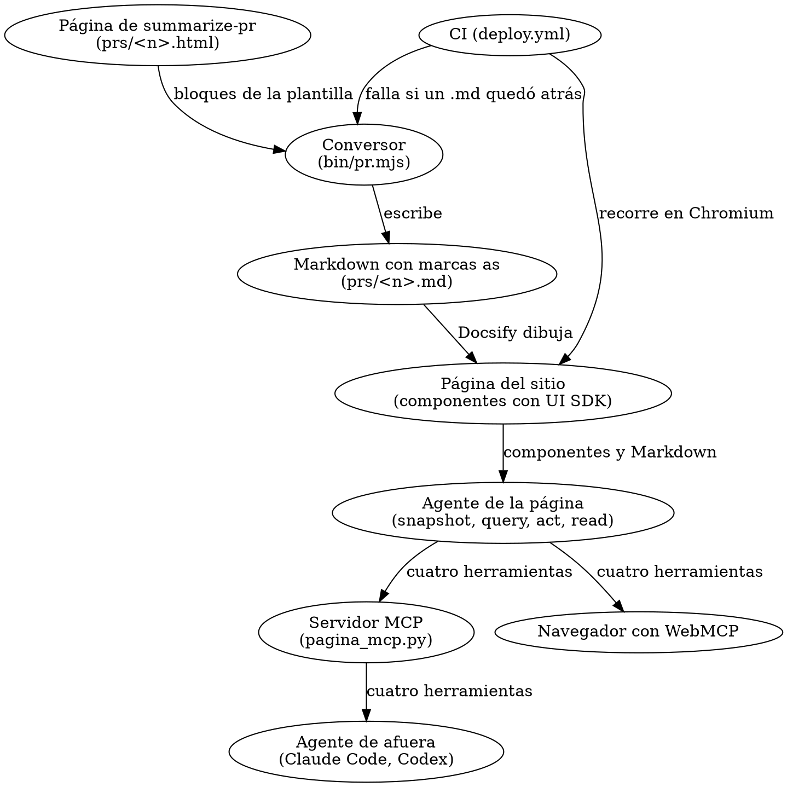

<!-- Hecho con `npm run docs:pr -- packages/docs-site/docs/prs/63.html` desde la página de summarize-pr. Para cambiarlo, cambiá 63.html y regeneralo. -->

# docs-site: resúmenes de PR sin iframe, con UI SDK y legibles por un agente

<!-- as: pr-header repo="https://github.com/Kiri23/DocsifyTemplate" pr="63" head="e650f939ee123dab0bcdefb28076d6462bdb9ca1" additions="8789" deletions="43" shown-additions="240" shown-deletions="6" -->
[Ver el original](63.html) · hecho con [summarize-pr](https://github.com/MeLlamoPablo/skills/tree/72199a8/skills/summarize-pr)

<!-- as: story -->
> **Before**, los resúmenes de PR de <dfn class="term" data-tip="Un skill que arma una página HTML con el resumen visual de un PR, para revisar su dirección sin leer todo el código. Esta página la hizo ese skill.">summarize-pr</dfn> (`prs/55` y `prs/59`) se veían en el sitio dentro de un iframe: raro en el teléfono (bandas arriba y abajo), y un agente desde la página no ve lo de adentro.
>
> **Now**, `prs/<n>.md` sale de `prs/<n>.html` con un conversor: Markdown con marcas <dfn class="term" data-tip="Un comentario HTML `as: nombre` antes de un bloque del Markdown. Le dice al sitio qué componente dibuja ese bloque.">as</dfn> cuyos componentes usan <dfn class="term" data-tip="Una librería de elementos web (acordeón, colapsable, control segmentado) con un agente: un modelo lee los componentes de la página y los usa con tres herramientas, snapshot, query y act.">UI SDK</dfn>, con el tema del sitio y sin iframe. El HTML queda como “Ver el original”.

La página como servidor MCP sirve para cualquier página del sitio, no solo PRs: cualquier doc de DocsifyTemplate pasa a ser algo que un agente lee y usa con 4 herramientas, sin DOM. El eval de prompt-bench (`examples/docsify-pr-agente`, en un PR aparte de prompt-bench) mide eso: Haiku 5.5 con solo esas 4 herramientas contestó 5 de 5 preguntas sobre #59.

Cierra [#62](https://github.com/Kiri23/DocsifyTemplate/issues/62). Nadie lo probó en Firefox ni en Safari (solo en Chromium headless). Nadie probó una tabla de tests escrita a mano; un bloque libre, solo en el fixture.

<!-- as: callout label="Note" -->
> El permiso de MeLlamoPablo para copiar summarize-pr es verbal (Twitter); su repo no tiene `LICENSE`. La copia y su atribución están en `pr/summarize-pr/` y en `NOTICE`.

## Flujo

<!-- as: chart -->


- `HTML`: [packages/docs-site/docs/prs/59.html#L658-L680](https://github.com/Kiri23/DocsifyTemplate/blob/e650f939ee123dab0bcdefb28076d6462bdb9ca1/packages/docs-site/docs/prs/59.html#L658-L680)
- `CONV`: [packages/docs-site/bin/pr.mjs#L31-L57](https://github.com/Kiri23/DocsifyTemplate/blob/e650f939ee123dab0bcdefb28076d6462bdb9ca1/packages/docs-site/bin/pr.mjs#L31-L57)
- `MD`: [packages/docs-site/docs/prs/59.md#L1-L20](https://github.com/Kiri23/DocsifyTemplate/blob/e650f939ee123dab0bcdefb28076d6462bdb9ca1/packages/docs-site/docs/prs/59.md#L1-L20)
- `SITE`: [packages/docs-site/components/pr/mod.js#L1-L11](https://github.com/Kiri23/DocsifyTemplate/blob/e650f939ee123dab0bcdefb28076d6462bdb9ca1/packages/docs-site/components/pr/mod.js#L1-L11)
- `AGENT`: [packages/docs-site/plugins/ui-sdk.js#L24-L43](https://github.com/Kiri23/DocsifyTemplate/blob/e650f939ee123dab0bcdefb28076d6462bdb9ca1/packages/docs-site/plugins/ui-sdk.js#L24-L43)
- `MCP`: [packages/docs-site/agente/pagina_mcp.py#L77-L111](https://github.com/Kiri23/DocsifyTemplate/blob/e650f939ee123dab0bcdefb28076d6462bdb9ca1/packages/docs-site/agente/pagina_mcp.py#L77-L111)
- `CI`: [.github/workflows/deploy.yml#L86-L98](https://github.com/Kiri23/DocsifyTemplate/blob/e650f939ee123dab0bcdefb28076d6462bdb9ca1/.github/workflows/deploy.yml#L86-L98)

## Un resumen en el sitio

El resumen de #59, antes y ahora. Cada bloque de la página de summarize-pr es una marca `as`; el código, los gráficos y los comentarios van en bloques de código tal cual. En GitHub se lee como un documento.

<!-- as: diff path="packages/docs-site/docs/prs/59.md" line="1" lang="markdown" href="https://github.com/Kiri23/DocsifyTemplate/pull/63/files#diff-f9654735553ffeae67e4ee23bf5d25dfda4f89578f0d5bcc393b2fc973af374fR1" -->
```markdown
# #59 · Glosario y resúmenes de PR

El resumen de [#59](https://github.com/Kiri23/DocsifyTemplate/pull/59), armado con el skill …

[#59](59.html ':include :type=iframe width=100% height=900px')
```

```markdown
<!-- Hecho con `npm run docs:pr -- packages/docs-site/docs/prs/59.html` desde … -->

# docs-site: glosario del repo en el sitio y resúmenes de PR (summarize-pr) enlazados a él

<!-- as: pr-header repo="…" pr="59" head="11ee4ef…" additions="2879" deletions="6" … -->
[Ver el original](59.html) · hecho con [summarize-pr](…)

<!-- as: story -->
> **Before**, ningún lugar definía los términos del repo. …
>
> **Now**, el sitio tiene una página “Glosario” armada de `GLOSSARY.md`, …

## El glosario y sus dos salidas

<!-- as: decision origin="implicit" -->
**El namespace de `vocabulary.ttl` sale del título del glosario**

- **Why:** El título “DocsifyTemplate” da `https://kiri231.com/vocabulario/docsifytemplate#`, …
- **Trade-off:** El vocabulario de MyClaudeSkills sigue con el suyo de antes (`…/glosario#`): …
```

<!-- as: example -->
```bash
# Escribe prs/59.md al lado de prs/59.html
npm run docs:pr -- packages/docs-site/docs/prs/59.html

# CI: falla si un .md no está al día
npm run docs:pr -- packages/docs-site/docs/prs/*.html --check
```

## Conversor y validador

El motor (`pr/`) es puro: lee el HTML como datos, escribe el Markdown y cuenta lo que tienen los dos. `bin/pr.mjs` es el transporte. Antes de escribir, corre el chequeo de summarize-pr sobre el HTML; después, compara el Markdown contra el HTML: los mismos bloques, cada texto y cada dato byte a byte (código de cada diff, DOT, tooltips, links, comentarios).

<!-- as: diff path="packages/docs-site/bin/pr.mjs" line="31" lang="javascript" only="new" href="https://github.com/Kiri23/DocsifyTemplate/pull/63/files#diff-c514479a1c9e79f25690ac1dfca5806a0a17e74f847dd50ff583e3c944309103R31" -->
```javascript
export function convert(file) {
  const html = readFileSync(file, "utf8");
  const { errors } = checkSummary(html);
  let page;
  try {
    page = readSummary(html);
  } catch (error) {
    if (error instanceof SummaryError) {
      return { markdown: null, problems: [error.message], warnings: errors };
    }
    throw error;
  }

  const markdown = toMarkdown(page, { original: basename(file), source: /* ... */ });
  const problems = [];
  const want = inventoryOfSummary(page);
  const got = inventoryOfMarkdown(markdown, COMPONENTS);
  for (const key of Object.keys(want)) {
    if (want[key] !== got[key]) {
      problems.push(`la página tiene ${want[key]} ${key} y el Markdown ${got[key]}`);
    }
  }

  const facts = factsOfSummary(page);
  const read = factsOfMarkdown(markdown, COMPONENTS);
  for (const key of Object.keys(facts)) {
    if (!isDeepStrictEqual(facts[key], read[key])) {
      problems.push(`${key}: el Markdown no dice lo mismo que la página`);
    }
  }

  const drawn = drawnText(markdown, COMPONENTS);
  for (const text of textOfSummary(html).filter((t) => !drawn.includes(t))) {
    problems.push(`falta el texto "${text}"`);
  }

  return { markdown, problems, warnings: errors };
}
```

El conversor toma una lista cerrada: los bloques de la plantilla y los <dfn class="term" data-tip="HTML propio de una página de summarize-pr que no es un bloque de la plantilla, por ejemplo una tabla con su propio CSS.">bloque libre</dfn>s. Un bloque que se parece a uno de la plantilla y no lo es lo hace fallar; el conversor nunca adivina.

<!-- as: diff path="packages/docs-site/pr/read-summary.mjs" line="86" lang="javascript" only="new" href="https://github.com/Kiri23/DocsifyTemplate/pull/63/files#diff-a0cf0185dd19734f13dab06354a4f151c18e3ef73db65584439c727d8c776ad7R86" -->
```javascript
/** Whether an element is one of the template's blocks (or tries to be one). */
function isCatalog(el) {
  return ["p", "pre", "details", "aside", "figure", "script"].includes(el.localName) ||
    /^h[1-6]$/.test(el.localName) || [...el.classList].some((c) => RESERVED.has(c));
}

function readBlock(el, at) {
  const is = (selector) => el.matches(selector);
  if (is("div.story")) { /* ... */ }
  if (is("p.note")) return { kind: "note", html: el.innerHTML };
  //! The same for callout, discarded, assumption, decision, diff, example,
  //! chart, chart-pair and tests
  // ...

  if (isCatalog(el)) {
    throw new SummaryError(
      `${at}: ${describe(el)} no es un bloque de la plantilla ni un bloque libre`,
    );
  }
  return { kind: "freeform", html: el.outerHTML };
}
```

## Componentes con UI SDK

<!-- as: decision origin="implicit" -->
**Los avatares salen de GitHub y las etiquetas de la plantilla quedan en inglés**

- **Why:** Los avatares de los comentarios salen de `github.com/<login>.png` en vez de data URIs. Las etiquetas de la plantilla (`Before/Now`, `Why`, `Trade-off`, `Decision`, `Implicit`) quedan en inglés, igual que en el HTML.
- **Trade-off:** Una página en español muestra esas etiquetas en inglés, y el lector carga cada avatar desde GitHub.

Un componente por bloque de la plantilla, en `components/pr/`, con la misma forma que los otros componentes del sitio. UI SDK va por dentro: `read` no lo conoce, y `check.mjs` sigue corriendo todo en Node; solo `view` dibuja `ui-accordion`, `ui-collapsible`, `ui-segmented-control` y `ui-hover-card`. El diseño visual está en `pr.css` y en 4 tokens nuevos de `tokens.css`.

<!-- as: diff path="packages/docs-site/components/pr/decision.js" line="18" lang="javascript" only="new" href="https://github.com/Kiri23/DocsifyTemplate/pull/63/files#diff-967a0264eaf128c8978f538d744a7f2a9031088c110dbaed560ead78368a4eadR18" -->
```javascript
export const decision = {
  name: "decision",
  takes: sequence("p", "ul"),
  attrs: ["origin", "slack"],
  read({ nodes: [title, list], attrs }) {
    // ...
    return {
      title: strong.innerHTML.trim(),
      // ...
      why: fields.Why[0][0],
      cost: fields["Trade-off"][0][0],
      discarded: fields["Discarded idea"],
    };
  },
  view: Decision,
};

function Decision({ title, label, implicit, slack, why, cost, discarded }) {
  // ...
  return html`<ui-accordion class="pr-decision" aria-label=${label}>
    <ui-accordion-item value="open">
      <ui-accordion-header>
        <!-- ... -->
      </ui-accordion-header>
      <ui-accordion-panel id=${id} hidden>
        <!-- ... -->
      </ui-accordion-panel>
    </ui-accordion-item>
  </ui-accordion>`;
}
```

Un diff tiene uno o dos bloques de código (un archivo nuevo o borrado tiene uno) y, a veces, la lista de comentarios. Por eso `sequence` acepta ahora una etiqueta opcional:

<!-- as: diff path="packages/docs-site/as/shapes.js" line="14" lang="javascript" href="https://github.com/Kiri23/DocsifyTemplate/pull/63/files#diff-dc5aa39a9ecfa575f85f816700f631be3b3c74de3000c5add14a85c2ff7f9870R14" -->
```javascript
/**
 * Elements one after the other, right after the marker: `sequence("pre", "ol")` is a code block
 * followed by a numbered list.
 * @param {...string} tags the tag of each element, in order
 */
export function sequence(...tags) {
  return shape({
    // ...
    collect(mark) {
      const nodes = [];
      let at = mark;
      for (const tag of tags) {
        const next = nextElement(at);
        if (!next || next.localName !== tag) {
          // ...
          throw new ShapeError(`esperaba <${tag}> ${after}, encontré ${found(next)}`);
        }
        nodes.push(next);
        at = next;
      }
      return nodes;
    },
  });
}
```

```javascript
/**
 * Elements one after the other, right after the marker: `sequence("pre", "ol")` is a code block
 * followed by a numbered list. A tag that ends in "?" may be missing: `sequence("pre", "pre?")` is
 * one code block or two. The props get only the elements that are there.
 * @param {...string} tags the tag of each element, in order
 */
export function sequence(...tags) {
  return shape({
    // ...
    collect(mark) {
      const nodes = [];
      let at = mark;
      // ...
      for (const said of tags) {
        const optional = said.endsWith("?");
        const tag = optional ? said.slice(0, -1) : said;
        const next = nextElement(at);
        if (!next || next.localName !== tag) {
          if (optional) continue;
          // ...
          throw new ShapeError(`esperaba <${tag}> ${after}, encontré ${found(next)}`);
        }
        nodes.push(next);
        at = next;
        // ...
      }
      return nodes;
    },
  });
}
```

<!-- as: diff path="packages/docs-site/components/pr/diff.js" line="31" lang="javascript" only="new" href="https://github.com/Kiri23/DocsifyTemplate/pull/63/files#diff-a400f56fdbb315588c97cdeceeced0df2ff2bf31af9d90b01154d17a881fb2ebR31" -->
```javascript
export const diff = {
  name: "diff",
  takes: sequence("pre", "pre?", "ul?"),
  attrs: ["path", "line", "lang", "name", "only", "href"],
  // ...
};

function Diff({ path, lang, name, href, old, new: neu, threads }) {
  // ...
  return html`<!-- ... -->
    ${hidden ? html`<ui-collapsible class="pr-hidden">
      <ui-collapsible-trigger>
        <button type="button" aria-expanded="false" title=${EXPANDER_TITLE}>
          ${`Hidden code of ${shown} (${hidden} lines)`}
        </button>
      </ui-collapsible-trigger>
      <ui-collapsible-panel hidden>${code(true)}</ui-collapsible-panel>
    </ui-collapsible>` : null}
    <div class="pr-code-shown">${code(false)}</div>
  <!-- ... -->`;
}
```

## El agente de la página

<!-- as: decision origin="implicit" -->
**La prosa le llega al agente con una herramienta `read` propia, al lado de las 3 de UI SDK**

- **Why:** `read` devuelve el Markdown de la página por sección y los términos con su definición. El <dfn class="term" data-tip="La herramienta de UI SDK que lista los componentes de la página y su estado (una decisión abierta o cerrada), sin lo que dicen.">snapshot</dfn> de UI SDK solo trae el título y la descripción de cada componente y salta lo oculto: ni con la decisión abierta trae el “por qué”. `definePrimitive` de UI SDK obligaba a reescribir el acordeón.
- **Trade-off:** El sitio mantiene una herramienta fuera de UI SDK. Para revertirlo, se saca `pageText`/`read` de `plugins/ui-sdk.js`.

<!-- as: decision origin="implicit" -->
**`window.agent` es el agente de UI SDK sin tocar, y `read` va aparte, en `window.pageText`**

- **Why:** El objeto de la librería queda como UI SDK lo hizo. Con <dfn class="term" data-tip="Una API propuesta para el navegador (`document.modelContext`) con la que una página le ofrece herramientas al agente del propio navegador.">WebMCP</dfn>, la página registra `read` con la misma forma que `registerTools` de UI SDK.
- **Trade-off:** Un agente que maneja el navegador busca las cuatro herramientas en dos objetos. Para revertirlo, se cambian los nombres en `plugins/ui-sdk.js`.

<!-- as: decision origin="implicit" -->
**`allow` deja pasar todo lo que pide el agente**

- **Why:** Una página de docs no tiene acciones que borren nada: el agente solo abre, cierra y cambia vistas.
- **Trade-off:** El agente no le pregunta al lector antes de actuar. Un sitio que lo quiera pasa su propio `allow`.

Desde la página (la consola, una extensión o Playwright):

<!-- as: example -->
```javascript
// Las 4 decisiones, el control Split/Unified, los tests por archivo
window.agent.snapshot()

// Cambia los diffs a unified
await window.agent.act({ steps: [{ ref: "Diff layout", action: "setValue", args: ["unified"] }] })

// La prosa de una sección: por qué, trade-off, notas, términos
window.pageText.read({ section: "Tests" })
```

<!-- as: diff path="packages/docs-site/plugins/ui-sdk.js" line="19" lang="javascript" only="new" href="https://github.com/Kiri23/DocsifyTemplate/pull/63/files#diff-699e23e35266762c7dc4a2f1e23936a14eebf59e8ef223ecdf5991e93de4de0dR19" -->
```javascript
/**
 * A docs page changes nothing that can't be undone: the agent may open, close and switch views.
 * A site can pass its own `allow` (for example, to ask the reader first).
 * @param {{ allow?: (step: object) => boolean | Promise<boolean> }} [options]
 */
export function uiSdk({ allow = () => true } = {}) {
  const agent = createAgent({ allow });
  const read = readTool();
  // For an agent that drives the browser (Playwright, an extension,
  // agente/pagina_mcp.py): UI SDK's agent as it is, and the page's `read` with
  // its description beside it.
  window.agent = agent;
  window.pageText = { read: read.run, tool: read.tool };

  // WebMCP: a browser that has an agent of its own gets the four tools. `read`
  // registers the way UI SDK's registerTools registers its three.
  const context = document.modelContext;
  if (context) {
    registerTools(agent, { allow });
    context.registerTool?.({
      ...read.tool,
      annotations: { readOnlyHint: true, untrustedContentHint: true, consequentialHint: false },
      execute: (input) => read.run(input),
    })?.catch?.(() => {});
  }

  return pageText(read);
}
```

Lo que lee el modelo sobre `read`:

<!-- as: diff path="packages/docs-site/plugins/page-text.js" line="77" lang="markdown" name="Agente de la página: descripción de read" only="new" href="https://github.com/Kiri23/DocsifyTemplate/pull/63/files#diff-cd2026fb42829e2136ce60a91cbed5bc802eae70aa5553119a322f80514ff863R77" -->
```markdown
Reads the text of the page, which snapshot leaves out: notes, the why and trade-off of each
decision (also closed ones), test names and the definition of each term. Without input it
returns the section titles, the terms and the top of the page; with `section` it returns
that section as Markdown.
```

Una sola copia de `@ui-sdk/core`: con dos, el snapshot del agente sale vacío.

<!-- as: diff path="packages/docs-site/site.js" line="41" lang="javascript" href="https://github.com/Kiri23/DocsifyTemplate/pull/63/files#diff-73984ba1f7574cd8b064b77b09c952429701eee315328d6529a206e69ddbbcb4R41" -->
```javascript
  // ...
  var imports = {
    "preact": "https://esm.sh/preact@10.29.8",
    // ...
    "htm/preact": "https://esm.sh/htm@3.1.1/preact?external=preact",
    "docs-site/": base,
  };
```

```javascript
  var UI_SDK = "0.1.0-beta.17";
  function uiSdk(part) {
    return "https://esm.sh/@ui-sdk/web@" + UI_SDK + "/" + part + "?deps=@ui-sdk/core@" + UI_SDK;
  }

  // ...
  var imports = {
    "preact": "https://esm.sh/preact@10.29.8",
    // ...
    "htm/preact": "https://esm.sh/htm@3.1.1/preact?external=preact",
    // UI SDK: one version, and every element pinned to the same @ui-sdk/core
    // (`deps`), so the page has one copy of it. With two, the agent's snapshot
    // comes back empty (test/ui-sdk.test.mjs).
    "@ui-sdk/web/accordion": uiSdk("accordion"),
    //! The same for collapsible, segmented-control and hover-card
    "@ui-sdk/web/agent": uiSdk("agent"),
    // The diff viewer and the charts of a PR summary, the versions summarize-pr uses.
    "@pierre/diffs": "https://cdn.jsdelivr.net/npm/@pierre/diffs@1.5.2/+esm",
    "@viz-js/viz": "https://cdn.jsdelivr.net/npm/@viz-js/viz@3.31.0/dist/viz.js",
    "docs-site/": base,
  };
```

<!-- as: discarded -->
> El `?bundle` de esm.sh no ayuda: 116 requests contra 119, y más KB (prototipo). Queda `?deps=@ui-sdk/core@<versión>` en el import map, que fija una sola copia de core.

## La página como servidor MCP

Para un agente de afuera, la página es un servidor MCP con esas cuatro herramientas y ninguna más. El agente no ve el DOM ni corre código.

<!-- as: example -->
```bash
# Abre prs/59 en un Chromium headless y sirve sus herramientas por stdio
python3 packages/docs-site/agente/pagina_mcp.py packages/docs-site/docs --page prs/59
```

<!-- as: diff path="packages/docs-site/agente/pagina_mcp.py" line="32" lang="python" only="new" href="https://github.com/Kiri23/DocsifyTemplate/pull/63/files#diff-5e70ff70b8d99d8b1541f0b57e5d06437c2ce88f2385408b32707f7d34a67866R32" -->
```python
def main():
    # ...
    with sync_playwright() as p:
        browser = p.chromium.launch()
        page = browser.new_page(viewport={"width": 1400, "height": 1000})
        page.goto(f"http://localhost:{port}/#/{opts.page}")
        # ...
        tools = page.evaluate("[...window.agent.tools, window.pageText.tool]")
        serve_mcp(page, tools)
    # ...


def serve_mcp(page, tools):
    """Answers MCP requests, one JSON per line on stdin, until stdin closes."""
    # ...
        elif method == "tools/call" and params.get("name") in names:
            name, arguments = params["name"], params.get("arguments") or {}
            try:
                # `read` is the site's (window.pageText); the other three are UI SDK's agent.
                out = page.evaluate(
                    "([name, input]) => Promise.resolve(name === 'read'"
                    " ? window.pageText.read(input) : window.agent[name](input))",
                    [name, arguments],
                )
                text = json.dumps(out, ensure_ascii=False)
                result = {"content": [{"type": "text", "text": text}]}
            except Exception as error:  # the page said no: the agent reads why
                result = {"content": [{"type": "text", "text": str(error)}], "isError": True}
```

## CI y deploy

<!-- as: decision origin="implicit" -->
**El job `build` corre en `ubuntu-24.04` y no en `ubuntu-latest` (26.04)**

- **Why:** Playwright todavía no trae Chromium para 26.04.
- **Trade-off:** El job queda fijo en una versión vieja de Ubuntu. Para revertirlo, se vuelve a `ubuntu-latest` cuando Playwright traiga Chromium para 26.04.

En Chromium, `test/pr_agente.py` prueba A (una sola copia de core), B (el agente ve lo mismo que el HTML), C (abre decisiones, cambia a `unified`, muestra código oculto), D (lee la prosa con `read`) y un chequeo por cada “The template shows…” de summarize-pr. WebMCP lo prueba con un navegador falso (registra las 4 herramientas y `read` contesta); con uno real, no.

<!-- as: diff path=".github/workflows/deploy.yml" line="72" lang="yaml" href="https://github.com/Kiri23/DocsifyTemplate/pull/63/files#diff-28802fbf11c83a2eee09623fb192785e7ca92a3f40602a517c011b947a1822d3R72" -->
```yaml
jobs:
  build:
    # ...
    runs-on: ubuntu-latest
    # ...
    steps:
      # ...
        run: |
          npm test
          # ...
          npm run docs:armar -- packages/docs-site/docs --root . --check

      - name: Build the image
```

```yaml
jobs:
  build:
    # ...
    # 24.04 and not ubuntu-latest (26.04): Playwright's Chromium doesn't run on
    # 26.04 yet, and the PR summaries are checked in it (test/pr_agente.py).
    runs-on: ubuntu-24.04
    # ...
    steps:
      # ...
        run: |
          npm test
          # ...
          npm run docs:armar -- packages/docs-site/docs --root . --check
          npm run docs:pr -- packages/docs-site/docs/prs/*.html --check

      # The PR summaries in Chromium, as a reader and as an AI agent sees them
      # (test/pr_agente.py, tests A–D of DocsifyTemplate#62): it loads UI SDK, the
      # diff viewer and Graphviz from their CDNs.
      - name: PR summaries in a browser, as an agent sees them
        run: |
          pip install playwright==1.55.0
          python -m playwright install --with-deps chromium
          python3 packages/docs-site/test/pr_agente.py

      - name: Build the image
```

<!-- as: decision origin="implicit" -->
**La imagen de deploy sirve `pr/summarize-pr/shown-lines.mjs`**

- **Why:** Los diffs de un resumen lo importan en el navegador para contar las líneas mostradas como lo cuenta summarize-pr.
- **Trade-off:** Un archivo de `pr/`, que es el motor de Node, también va en la imagen del sitio. Fuera de este diff, el skill `pr-corto` (MyClaudeSkills, ya en `main`) ahora dice que, si el repo tiene `npm run docs:pr`, el HTML pasa por el conversor.

<!-- as: diff path="deploy/Dockerfile" line="24" lang="dockerfile" href="https://github.com/Kiri23/DocsifyTemplate/pull/63/files#diff-5b6228cfe643850b0b1c8d2b5d69430bb121272e145b651c2ff6a85c23895b4eR24" -->
```dockerfile
COPY packages/docs-site/theme /srv/theme
```

```dockerfile
COPY packages/docs-site/theme /srv/theme
# The diffs of a PR summary count their lines with summarize-pr's own code
# (components/pr/code-lines.js).
COPY packages/docs-site/pr/summarize-pr/shown-lines.mjs /srv/pr/summarize-pr/shown-lines.mjs
```

## Tests

<!-- as: tests -->
- `packages/docs-site/test/pr.test.mjs`
  - _Cases of one test_
    - added L51: [\#55: summarize-pr's check passes on the page that comes in](https://github.com/Kiri23/DocsifyTemplate/pull/63/files#diff-13349ee1bcc5f6f9b87be870afd5074a8ac3c333043e92e06498e871a1059df6R51)
    - added L51: [\#59: summarize-pr's check passes on the page that comes in](https://github.com/Kiri23/DocsifyTemplate/pull/63/files#diff-13349ee1bcc5f6f9b87be870afd5074a8ac3c333043e92e06498e871a1059df6R51)
    - added L51: [\#7: summarize-pr's check passes on the page that comes in](https://github.com/Kiri23/DocsifyTemplate/pull/63/files#diff-13349ee1bcc5f6f9b87be870afd5074a8ac3c333043e92e06498e871a1059df6R51)
  - _Cases of one test_
    - added L71: [the converter refuses a bare &lt;pre&gt;](https://github.com/Kiri23/DocsifyTemplate/pull/63/files#diff-13349ee1bcc5f6f9b87be870afd5074a8ac3c333043e92e06498e871a1059df6R71)
    - added L71: [the converter refuses a &lt;p&gt; without a class](https://github.com/Kiri23/DocsifyTemplate/pull/63/files#diff-13349ee1bcc5f6f9b87be870afd5074a8ac3c333043e92e06498e871a1059df6R71)
    - added L71: [the converter refuses an aside of no kind](https://github.com/Kiri23/DocsifyTemplate/pull/63/files#diff-13349ee1bcc5f6f9b87be870afd5074a8ac3c333043e92e06498e871a1059df6R71)
    - added L71: [the converter refuses a decision with no trade-off](https://github.com/Kiri23/DocsifyTemplate/pull/63/files#diff-13349ee1bcc5f6f9b87be870afd5074a8ac3c333043e92e06498e871a1059df6R71)
    - added L71: [the converter refuses a &lt;style&gt; with no block after it](https://github.com/Kiri23/DocsifyTemplate/pull/63/files#diff-13349ee1bcc5f6f9b87be870afd5074a8ac3c333043e92e06498e871a1059df6R71)
    - added L71: [the converter refuses a freeform block that takes a template class](https://github.com/Kiri23/DocsifyTemplate/pull/63/files#diff-13349ee1bcc5f6f9b87be870afd5074a8ac3c333043e92e06498e871a1059df6R71)
  - added L76: [a table with its own &lt;style&gt; is a freeform block](https://github.com/Kiri23/DocsifyTemplate/pull/63/files#diff-13349ee1bcc5f6f9b87be870afd5074a8ac3c333043e92e06498e871a1059df6R76)
  - added L81: [template.html, with every block of the catalog, converts and draws](https://github.com/Kiri23/DocsifyTemplate/pull/63/files#diff-13349ee1bcc5f6f9b87be870afd5074a8ac3c333043e92e06498e871a1059df6R81)
  - _Cases of one test_
    - added L92: [\#55: 55.md is what the converter writes from 55.html](https://github.com/Kiri23/DocsifyTemplate/pull/63/files#diff-13349ee1bcc5f6f9b87be870afd5074a8ac3c333043e92e06498e871a1059df6R92)
    - added L92: [\#59: 59.md is what the converter writes from 59.html](https://github.com/Kiri23/DocsifyTemplate/pull/63/files#diff-13349ee1bcc5f6f9b87be870afd5074a8ac3c333043e92e06498e871a1059df6R92)
    - added L92: [\#7: 7.md is what the converter writes from 7.html](https://github.com/Kiri23/DocsifyTemplate/pull/63/files#diff-13349ee1bcc5f6f9b87be870afd5074a8ac3c333043e92e06498e871a1059df6R92)
  - _Cases of one test_
    - added L100: [\#55: the Markdown has the same blocks as the page](https://github.com/Kiri23/DocsifyTemplate/pull/63/files#diff-13349ee1bcc5f6f9b87be870afd5074a8ac3c333043e92e06498e871a1059df6R100)
    - added L100: [\#59: the Markdown has the same blocks as the page](https://github.com/Kiri23/DocsifyTemplate/pull/63/files#diff-13349ee1bcc5f6f9b87be870afd5074a8ac3c333043e92e06498e871a1059df6R100)
    - added L100: [\#7: the Markdown has the same blocks as the page](https://github.com/Kiri23/DocsifyTemplate/pull/63/files#diff-13349ee1bcc5f6f9b87be870afd5074a8ac3c333043e92e06498e871a1059df6R100)
  - _Cases of one test_
    - added L107: [\#55: the code of each diff, the charts, the tooltips and the links arrive byte by byte](https://github.com/Kiri23/DocsifyTemplate/pull/63/files#diff-13349ee1bcc5f6f9b87be870afd5074a8ac3c333043e92e06498e871a1059df6R107)
    - added L107: [\#59: the code of each diff, the charts, the tooltips and the links arrive byte by byte](https://github.com/Kiri23/DocsifyTemplate/pull/63/files#diff-13349ee1bcc5f6f9b87be870afd5074a8ac3c333043e92e06498e871a1059df6R107)
    - added L107: [\#7: the code of each diff, the charts, the tooltips and the links arrive byte by byte](https://github.com/Kiri23/DocsifyTemplate/pull/63/files#diff-13349ee1bcc5f6f9b87be870afd5074a8ac3c333043e92e06498e871a1059df6R107)
  - _Cases of one test_
    - added L111: [\#55: every text of the page's &lt;main&gt; is on the drawn page](https://github.com/Kiri23/DocsifyTemplate/pull/63/files#diff-13349ee1bcc5f6f9b87be870afd5074a8ac3c333043e92e06498e871a1059df6R111)
    - added L111: [\#59: every text of the page's &lt;main&gt; is on the drawn page](https://github.com/Kiri23/DocsifyTemplate/pull/63/files#diff-13349ee1bcc5f6f9b87be870afd5074a8ac3c333043e92e06498e871a1059df6R111)
    - added L111: [\#7: every text of the page's &lt;main&gt; is on the drawn page](https://github.com/Kiri23/DocsifyTemplate/pull/63/files#diff-13349ee1bcc5f6f9b87be870afd5074a8ac3c333043e92e06498e871a1059df6R111)
  - _Cases of one test_
    - added L117: [\#55: the header counts the shown lines as summarize-pr's check does](https://github.com/Kiri23/DocsifyTemplate/pull/63/files#diff-13349ee1bcc5f6f9b87be870afd5074a8ac3c333043e92e06498e871a1059df6R117)
    - added L117: [\#59: the header counts the shown lines as summarize-pr's check does](https://github.com/Kiri23/DocsifyTemplate/pull/63/files#diff-13349ee1bcc5f6f9b87be870afd5074a8ac3c333043e92e06498e871a1059df6R117)
    - added L117: [\#7: the header counts the shown lines as summarize-pr's check does](https://github.com/Kiri23/DocsifyTemplate/pull/63/files#diff-13349ee1bcc5f6f9b87be870afd5074a8ac3c333043e92e06498e871a1059df6R117)
- `packages/docs-site/test/ui-sdk.test.mjs`
  - added L40: [A: every @ui-sdk module of the import map has one version and pins @ui-sdk/core to it](https://github.com/Kiri23/DocsifyTemplate/pull/63/files#diff-40cda6d108df52481d82afb2146ba56d125294f8b467020c9a7ce1643e99c545R40)
  - added L54: [A: the site's code imports UI SDK only through the import map, and the components not at all](https://github.com/Kiri23/DocsifyTemplate/pull/63/files#diff-40cda6d108df52481d82afb2146ba56d125294f8b467020c9a7ce1643e99c545R54)
  - added L66: [read: the outline names every section and every term with its definition](https://github.com/Kiri23/DocsifyTemplate/pull/63/files#diff-40cda6d108df52481d82afb2146ba56d125294f8b467020c9a7ce1643e99c545R66)
  - added L76: [read: a section comes whole, with the why and the trade-off of its closed decisions](https://github.com/Kiri23/DocsifyTemplate/pull/63/files#diff-40cda6d108df52481d82afb2146ba56d125294f8b467020c9a7ce1643e99c545R76)
  - added L83: [read: a section that isn't there says which ones are](https://github.com/Kiri23/DocsifyTemplate/pull/63/files#diff-40cda6d108df52481d82afb2146ba56d125294f8b467020c9a7ce1643e99c545R83)
  - added L87: [read: a ## inside a code block is not a section](https://github.com/Kiri23/DocsifyTemplate/pull/63/files#diff-40cda6d108df52481d82afb2146ba56d125294f8b467020c9a7ce1643e99c545R87)
- `packages/docs-site/test/pr-catalogo.test.mjs`
  - added L21: [summarize-pr's template has the same blocks as the copy the converter knows](https://github.com/Kiri23/DocsifyTemplate/pull/63/files#diff-1bfa81a6183945c3046111bbd8cf490f084ee65cb6aeec52971db3de21892aa8R21)
