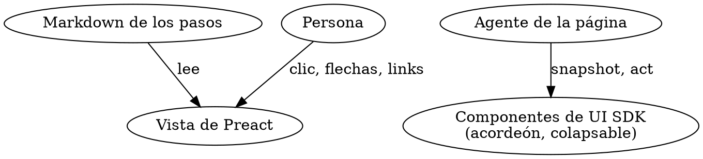
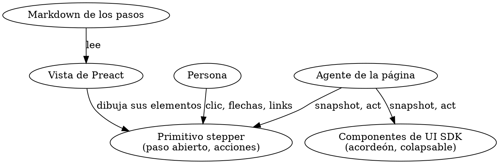

<!-- Hecho con `npm run docs:pr -- packages/docs-site/docs/prs/66.html` desde la página de summarize-pr. Para cambiarlo, cambiá 66.html y regeneralo. -->

# docs-site: el stepper como primitivo propio de UI SDK, que un agente ve y mueve

<!-- as: pr-header repo="https://github.com/Kiri23/DocsifyTemplate" pr="66" head="1287fef167926e8395abc082476dd9cdfc96f62c" additions="367" deletions="59" shown-additions="69" shown-deletions="10" -->
[Ver el original](66.html) · hecho con [summarize-pr](https://github.com/MeLlamoPablo/skills/tree/72199a8/skills/summarize-pr)

<!-- as: story -->
> **Before**, el stepper guardaba el paso abierto en el estado de Preact. Un agente de la página ya usaba los componentes de <dfn class="term" data-tip="Una librería de elementos web (acordeón, colapsable, control segmentado) con un agente: un modelo lee los componentes de la página y los usa con tres herramientas, snapshot, query y act.">UI SDK</dfn> (acordeón, colapsable), pero no veía el stepper.
>
> **Now**, el stepper es un <dfn class="term" data-tip="Un componente hecho con `definePrimitive` de UI SDK: declara su estado, sus partes y sus acciones, y UI SDK le conecta el mouse, el teclado y el agente.">primitivo</dfn> propio: declara su estado (el paso abierto), sus partes y sus acciones (`setValue`, `next`, `previous`). El agente lo ve en el <dfn class="term" data-tip="La herramienta del agente de UI SDK que lista los componentes de la página con su estado y sus acciones.">snapshot</dfn> y lo mueve con `act`, sin una herramienta escrita para él. Para la persona nada cambia: clic, flechas, Home/End y links a un paso.

Cualquier componente propio (la terminal, el glosario como tabla, la retro semanal, un tablero) queda operable por un agente si declara sus acciones una vez. El mouse, el teclado y el agente mueven el mismo estado. Es la base de [#65](https://github.com/Kiri23/DocsifyTemplate/issues/65), donde un agente modificará su propia página.

Este PR apunta a la rama de [#63](https://github.com/Kiri23/DocsifyTemplate/pull/63) (abierto) para mostrar solo la diferencia. Refs [#62](https://github.com/Kiri23/DocsifyTemplate/issues/62). Nadie miró el stepper en el teléfono con este cambio; su CSS del teléfono no cambió.

## Flujo

<!-- as: chart-pair -->
**Before**



- `MD`: [packages/docs-site/docs/componentes/stepper.md#L1-L20](https://github.com/Kiri23/DocsifyTemplate/blob/1287fef167926e8395abc082476dd9cdfc96f62c/packages/docs-site/docs/componentes/stepper.md#L1-L20)
- `VIEW`: [packages/docs-site/components/stepper.js#L41-L75](https://github.com/Kiri23/DocsifyTemplate/blob/1287fef167926e8395abc082476dd9cdfc96f62c/packages/docs-site/components/stepper.js#L41-L75)
- `AGENT`: [packages/docs-site/plugins/ui-sdk.js#L25-L30](https://github.com/Kiri23/DocsifyTemplate/blob/1287fef167926e8395abc082476dd9cdfc96f62c/packages/docs-site/plugins/ui-sdk.js#L25-L30)

**Now**



- `MD`: [packages/docs-site/docs/componentes/stepper.md#L1-L20](https://github.com/Kiri23/DocsifyTemplate/blob/1287fef167926e8395abc082476dd9cdfc96f62c/packages/docs-site/docs/componentes/stepper.md#L1-L20)
- `VIEW`: [packages/docs-site/components/stepper.js#L41-L75](https://github.com/Kiri23/DocsifyTemplate/blob/1287fef167926e8395abc082476dd9cdfc96f62c/packages/docs-site/components/stepper.js#L41-L75)
- `PRIM`: [packages/docs-site/plugins/stepper.js#L28-L126](https://github.com/Kiri23/DocsifyTemplate/blob/1287fef167926e8395abc082476dd9cdfc96f62c/packages/docs-site/plugins/stepper.js#L28-L126)
- `AGENT`: [packages/docs-site/plugins/ui-sdk.js#L25-L30](https://github.com/Kiri23/DocsifyTemplate/blob/1287fef167926e8395abc082476dd9cdfc96f62c/packages/docs-site/plugins/ui-sdk.js#L25-L30)

## Lo que ve un agente

El stepper en el snapshot del agente, en la página del componente:

<!-- as: example -->
```json
{ "component": "stepper", "label": "Pasos", "value": 1, "actions": ["setValue", "next", "previous"],
  "items": [{ "value": "1", "label": "Agregá el término" }, …] }
```

<!-- as: example -->
```javascript
// Va al paso 3; la persona ve el paso 3
agent.act({ steps: [{ ref: "Pasos", action: "setValue", args: [3] }] })

// Un paso más
agent.act({ steps: [{ ref: "Pasos", action: "next" }] })

// Un paso que no existe: "No step 9: this stepper has steps 1 to 4."
agent.act({ steps: [{ ref: "Pasos", action: "setValue", args: [9] }] })
```

## El primitivo

<!-- as: decision origin="implicit" -->
**El primitivo dice explícitamente qué puede hacer el agente (`agent: { actions: [...] }`)**

- **Why:** El <dfn class="term" data-tip="La parte de UI SDK que encuentra cada primitivo de la página y le da al agente sus herramientas (snapshot, query, act).">puente del agente</dfn> adivinaría esos tres nombres solo. La lista deja afuera cualquier otro método.
- **Trade-off:** Una acción nueva del stepper no le llega al agente hasta que alguien la agrega a la lista.

<!-- as: diff path="packages/docs-site/plugins/stepper.js" line="19" lang="javascript" only="new" href="https://github.com/Kiri23/DocsifyTemplate/pull/66/files#diff-646ace470b4dd5b5fc5366373631f139337e3fb6ab24119ca782ed04e6840423R19" -->
```javascript
/** The step a stepper starts at, or one it is asked for, as a whole number from 1 to `count`. */
function stepOf(value, count) {
  const step = Number(value);
  if (!Number.isInteger(step) || step < 1 || step > count) {
    throw new Error(`No step ${JSON.stringify(value)}: this stepper has steps 1 to ${count}.`);
  }
  return step;
}

export const stepperPrimitive = definePrimitive({
  name: "stepper",
  options: { count: "number", defaultValue: "number", onValueChange: "callback" },
  state: (options) => ({ value: options.defaultValue ?? 1, count: options.count ?? 1 }),
  // ...
  api: (context) => {
    // ...
    return {
      setValue,
      next: (event) => current() < count() && setValue(current() + 1, event),
      previous: (event) => current() > 1 && setValue(current() - 1, event),
    };
  },
  slots: (slot) => ({
    // A link to a step's heading (from "On this page" or the search) opens that step.
    root: slot({ role: "group", bind: /* ... */ }),
    list: slot({ role: "tablist", keys: ["ArrowLeft", "ArrowRight", "Home", "End"], /* ... */ }),
    tab: slot({
      role: "tab",
      press: ({ api, props }, event) => api.setValue(props.value, event),
      // ...
    }),
    //! The same for the panel, the previous and next buttons, and the "Paso 2 de 4" line
    // ...
  }),
  // What an agent can do: go to a step, or one forward or back.
  agent: { actions: ["setValue", "next", "previous"] },
});

/** The stepper's elements; components/stepper.js draws them. */
export function defineStepper() {
  // ...
  createParts(stepperPrimitive, { root: "as-stepper", list: "as-stepper-list", /* ... */ });
}
```

<!-- as: discarded -->
> `ui-tabs` de UI SDK ya trae la lista, las pestañas, los paneles y las flechas: con eso el stepper salía con menos código. El autor lo hizo con `definePrimitive` a propósito, como ejemplo de un componente que UI SDK no trae. El código y la página del componente lo dicen.

## La vista de Preact

<!-- as: decision origin="implicit" -->
**Los elementos se llaman `as-stepper-*` y el agente encuentra el stepper por la etiqueta “Pasos”**

- **Why:** El prefijo `as-` es el de los componentes del sitio, y “Pasos” es la etiqueta que ya tenía la lista de pasos.
- **Trade-off:** Dos steppers en una página tienen la misma etiqueta para el agente.

La vista lee el Markdown como antes y sigue moviendo los nodos de la página a los paneles. El estado, las teclas y los links a un paso pasan al primitivo.

<!-- as: diff path="packages/docs-site/components/stepper.js" line="42" lang="javascript" href="https://github.com/Kiri23/DocsifyTemplate/pull/66/files#diff-1c18f856f8753ffd9b8523a8f29ff966a69485ffdcff3d6286e9d79f2760dd76R42" -->
```javascript
function Stepper({ steps }) {
  const [current, setCurrent] = useState(/* ... */);
  // ...

  // A link to one of the headings opens its step.
  useEffect(() => { /* ... */ }, []);

  const go = (i, focus) => { /* ... */ };
  const onKey = (event, i) => { /* ... */ };

  return html`
    <div class="as-st">
      <div class="as-st-tabs" role="tablist" aria-label="Pasos" /* ... */>
        <button role="tab" onClick=${() => go(i)} onKeyDown=${(e) => onKey(e, i)} /* ... */>
        // ...
      <div role="tabpanel" class="as-st-panel" hidden=${i !== current} /* ... */></div>
      // ...
      <button disabled=${current === 0} onClick=${() => go(current - 1)}>← Paso anterior</button>
      // ...
  `;
}
```

```javascript
// The stepper's behavior (which step is open, the keys, what an agent can do) is a UI SDK
// primitive in plugins/stepper.js; this view only draws its elements, and moves the page's
// nodes into the panels.
function Stepper({ steps }) {
  const start = Math.max(0, steps.findIndex((s) => s.id === linkedId())) + 1;
  // ...

  return html`
    <as-stepper class="as-st" count=${steps.length} default-value=${start} aria-label="Pasos">
      <as-stepper-list class="as-st-tabs" aria-label="Pasos" /* ... */>
        <as-stepper-tab value=${i + 1}><button type="button" role="tab" /* ... */>
        // ...
      <as-stepper-panel value=${i + 1} class="as-st-panel" hidden=${i + 1 !== start} /* ... */>
      // ...
      <as-stepper-previous><button type="button">← Paso anterior</button></as-stepper-previous>
      // ...
  `;
}
```

## Import map y registro

<!-- as: decision origin="implicit" -->
**3 archivos sueltos de UI SDK en vez de las entradas raíz**

- **Why:** La raíz de `@ui-sdk/web` carga unos 60 componentes. Estos son los mismos archivos que cargan los elementos `ui-*`, así que la página tiene una sola copia del núcleo de UI SDK; con dos, el puente no ve el stepper.
- **Trade-off:** Los 3 archivos no están en el mapa de `exports` de UI SDK: una versión nueva podría moverlos. Para revertirlo, se cambian 3 líneas del import map.

<!-- as: assumption -->
> `esm.sh` sirve archivos de UI SDK que no están en su mapa de `exports`. Si deja de hacerlo, la prueba en Chromium falla.

<!-- as: diff path="packages/docs-site/site.js" line="45" lang="javascript" href="https://github.com/Kiri23/DocsifyTemplate/pull/66/files#diff-73984ba1f7574cd8b064b77b09c952429701eee315328d6529a206e69ddbbcb4R45" -->
```javascript
function uiSdk(part) {
  return "https://esm.sh/@ui-sdk/web@" + UI_SDK + "/" + part + "?deps=@ui-sdk/core@" + UI_SDK;
}
var imports = {
  // ...
  "@ui-sdk/web/agent": uiSdk("agent"),
  // ...
};
```

```javascript
function uiSdk(part) {
  return "https://esm.sh/@ui-sdk/web@" + UI_SDK + "/" + part + "?deps=@ui-sdk/core@" + UI_SDK;
}
function uiSdkCore(file) {
  return "https://esm.sh/@ui-sdk/core@" + UI_SDK + "/" + file;
}
var imports = {
  // ...
  "@ui-sdk/web/agent": uiSdk("agent"),
  // For a primitive of our own (plugins/stepper.js): the same files the elements above load.
  "@ui-sdk/web/define-element": uiSdk("dist/define-element.js"),
  "@ui-sdk/core/primitive": uiSdkCore("dist/foundation/kernel/primitive.js"),
  "@ui-sdk/core/input-source": uiSdkCore("dist/foundation/kernel/input-source.js"),
  // ...
};
```

El plugin de UI SDK registra el stepper antes de crear el agente:

<!-- as: diff path="packages/docs-site/plugins/ui-sdk.js" line="26" lang="javascript" href="https://github.com/Kiri23/DocsifyTemplate/pull/66/files#diff-699e23e35266762c7dc4a2f1e23936a14eebf59e8ef223ecdf5991e93de4de0dR26" -->
```javascript
export function uiSdk({ allow = () => true } = {}) {
  const agent = createAgent({ allow });
  // ...
}
```

```javascript
export function uiSdk({ allow = () => true } = {}) {
  // Our own primitives, next to UI SDK's elements: the bridge sees them alike.
  defineStepper();
  const agent = createAgent({ allow });
  // ...
}
```

## Tests

CI corre la prueba en Chromium en cada PR, después de la de los resúmenes de PR.

<!-- as: tests -->
- `packages/docs-site/test/stepper_agente.py`
  - added L91: [the agent's snapshot lists the stepper, its step and its actions](https://github.com/Kiri23/DocsifyTemplate/pull/66/files#diff-643534530e9bf14cf33a3b60d07b82a394283b2a36dd82bfd22ea8efe3f1e973R91)
  - added L93: [the stepper has a name a step can use as its ref](https://github.com/Kiri23/DocsifyTemplate/pull/66/files#diff-643534530e9bf14cf33a3b60d07b82a394283b2a36dd82bfd22ea8efe3f1e973R93)
  - added L96: [act setValue(3) opens the third step for the person too](https://github.com/Kiri23/DocsifyTemplate/pull/66/files#diff-643534530e9bf14cf33a3b60d07b82a394283b2a36dd82bfd22ea8efe3f1e973R96)
  - added L100: [act next goes one forward, and at the last step the person's Next is off](https://github.com/Kiri23/DocsifyTemplate/pull/66/files#diff-643534530e9bf14cf33a3b60d07b82a394283b2a36dd82bfd22ea8efe3f1e973R100)
  - added L104: [a step that isn't there is refused with the steps there are](https://github.com/Kiri23/DocsifyTemplate/pull/66/files#diff-643534530e9bf14cf33a3b60d07b82a394283b2a36dd82bfd22ea8efe3f1e973R104)
  - added L108: [a click on Previous goes one back](https://github.com/Kiri23/DocsifyTemplate/pull/66/files#diff-643534530e9bf14cf33a3b60d07b82a394283b2a36dd82bfd22ea8efe3f1e973R108)
  - added L115: [Home and the arrows move the step and the focus](https://github.com/Kiri23/DocsifyTemplate/pull/66/files#diff-643534530e9bf14cf33a3b60d07b82a394283b2a36dd82bfd22ea8efe3f1e973R115)
  - added L119: [the snapshot follows the person's changes](https://github.com/Kiri23/DocsifyTemplate/pull/66/files#diff-643534530e9bf14cf33a3b60d07b82a394283b2a36dd82bfd22ea8efe3f1e973R119)
  - added L130: [a link to a step's heading opens that step](https://github.com/Kiri23/DocsifyTemplate/pull/66/files#diff-643534530e9bf14cf33a3b60d07b82a394283b2a36dd82bfd22ea8efe3f1e973R130)
- `packages/docs-site/test/ui-sdk.test.mjs`
  - modified L40: [A: every @ui-sdk module of the import map has one version and pins @ui-sdk/core to it](https://github.com/Kiri23/DocsifyTemplate/pull/66/files#diff-40cda6d108df52481d82afb2146ba56d125294f8b467020c9a7ce1643e99c545R40)
