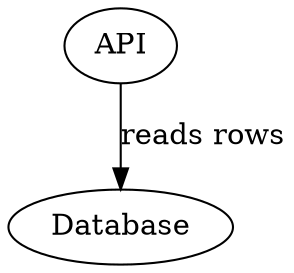
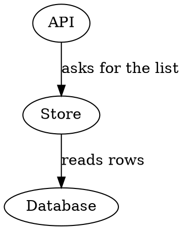

<!-- Hecho con `npm run docs:pr -- packages/docs-site/test/fixtures/pr/7.html` desde la página de summarize-pr. Para cambiarlo, cambiá 7.html y regeneralo. -->

# store: sort a collection list by its own sort

<!-- as: pr-header repo="https://github.com/acme/shop" pr="7" head="0123456789abcdef0123456789abcdef01234567" additions="120" deletions="40" shown-additions="6" shown-deletions="2" preview="https://preview.example.com/?pr=7&x=1" -->
[Ver el original](7.html) · hecho con [summarize-pr](https://github.com/MeLlamoPablo/skills/tree/72199a8/skills/summarize-pr)

- experiment: list-sort

<!-- as: story -->
> **Before**, the server sorted every list by the default order.
>
> **Now**, the server sorts a collection list by its own sort, then by the default order.

The <dfn class="term" data-tip="The job that removes old rows from the `orders` table.">sweeper</dfn> keeps its order. See [#5](https://github.com/acme/shop/pull/5).

<!-- as: callout label="Note" -->
> Only the CMS reads the new sort.

<!-- as: decision slack="https://acme.slack.com/archives/C1/p1" -->
**The sort lives in the store, not in the query**

- **Why:** The store already knows each list’s settings.
- **Trade-off:** The sweeper reads the old order until it moves.
- **Discarded idea:** A sort in SQL. Each sweeper run would sort again.

## Flow

<!-- as: chart-pair -->
**Before**



- `API`: [src/api.ts#L1-L9](https://github.com/acme/shop/blob/0123456789abcdef0123456789abcdef01234567/src/api.ts#L1-L9)

**Now**



- `API`: [src/api.ts#L1-L12](https://github.com/acme/shop/blob/0123456789abcdef0123456789abcdef01234567/src/api.ts#L1-L12)
- `STORE`: [src/store.ts#L4](https://github.com/acme/shop/blob/0123456789abcdef0123456789abcdef01234567/src/store.ts#L4)

## Store

<!-- as: decision origin="implicit" -->
**A list without a sort uses the default order**

- **Why:** Old lists have no sort yet.
- **Trade-off:** An editor can’t tell an unset sort from the default one.

<!-- as: assumption -->
> Every list has a sort.

<!-- as: diff path="src/store.ts" line="12" lang="typescript" href="https://github.com/acme/shop/pull/7/files#diff-2717c7fb31c2070dd96f07394997809bc9be7f3fff03ab638db696cc480f39b6R12" -->
```typescript
export class Store {
	//{
	constructor(private db: Db) {}
	//}
	list(id: string) {
		return this.db.rows(id)
	}
}
```

```typescript
export class Store {
	//{
	constructor(private db: Db) {}
	//}
	list(id: string) {
		//! The list's own sort first.
		return sortBy(this.db.rows(id), this.settings(id).sort, defaultOrder)
	}
}
```

- new:6 · [@octocat](https://github.com/acme/shop/pull/7#discussion_r1)
  ```markdown
  Does this keep #5 working? cc @hubot
  ```
- new:6 · [@mona](https://github.com/acme/shop/pull/7#discussion_r2)
  ```markdown
  Yes: `defaultOrder` is the old order.
  ```

<!-- as: example -->
```typescript
// Lists the products of a collection, in its own sort.
await store.list("summer")
```

<div class="pr-freeform">
<style>.sort-cost td { text-align: right; color: var(--muted); }</style>
<div class="table-wrap sort-cost"><table><tr><th>Path</th><th>Queries</th></tr><tr><td>list</td><td>1 → 1 ✓</td></tr></table></div>
</div>

<!-- as: discarded -->
> A cache of sorted lists.

## Tests

<!-- as: tests -->
- `src/store.test.ts`
  - **Store list**
    - added L10: [sorts by the list’s sort](https://github.com/acme/shop/pull/7/files#diff-ddc9c8d20a444c5816842bd1a8c0243f43928a25242d8748460da5d96f457369R10)
    - modified L20: [falls back to the default order](https://github.com/acme/shop/pull/7/files#diff-ddc9c8d20a444c5816842bd1a8c0243f43928a25242d8748460da5d96f457369R20) (renamed from src/old.test.ts:4)
  - _Cases of one test_
    - added L30: [sorts with asc](https://github.com/acme/shop/pull/7/files#diff-ddc9c8d20a444c5816842bd1a8c0243f43928a25242d8748460da5d96f457369R30)
    - added L30: [sorts with desc](https://github.com/acme/shop/pull/7/files#diff-ddc9c8d20a444c5816842bd1a8c0243f43928a25242d8748460da5d96f457369R30)
  - removed L40: [sorts in SQL](https://github.com/acme/shop/pull/7/files#diff-ddc9c8d20a444c5816842bd1a8c0243f43928a25242d8748460da5d96f457369L40)
